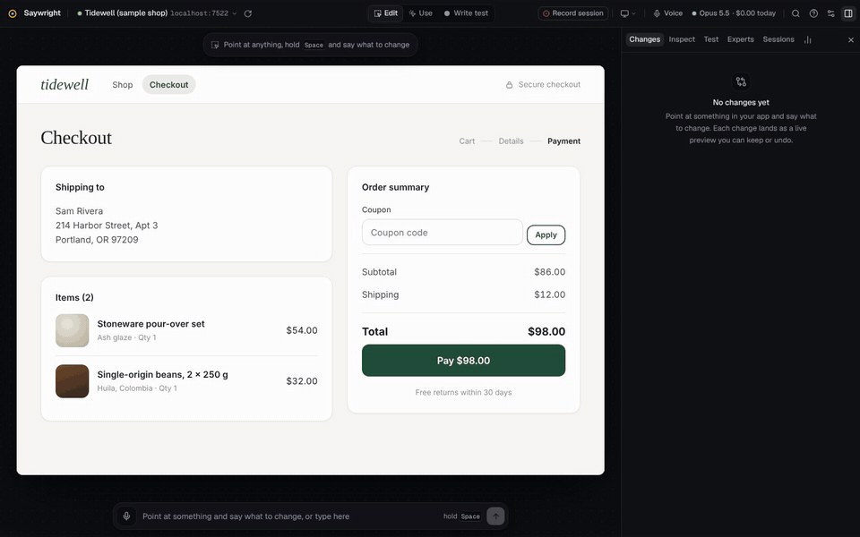
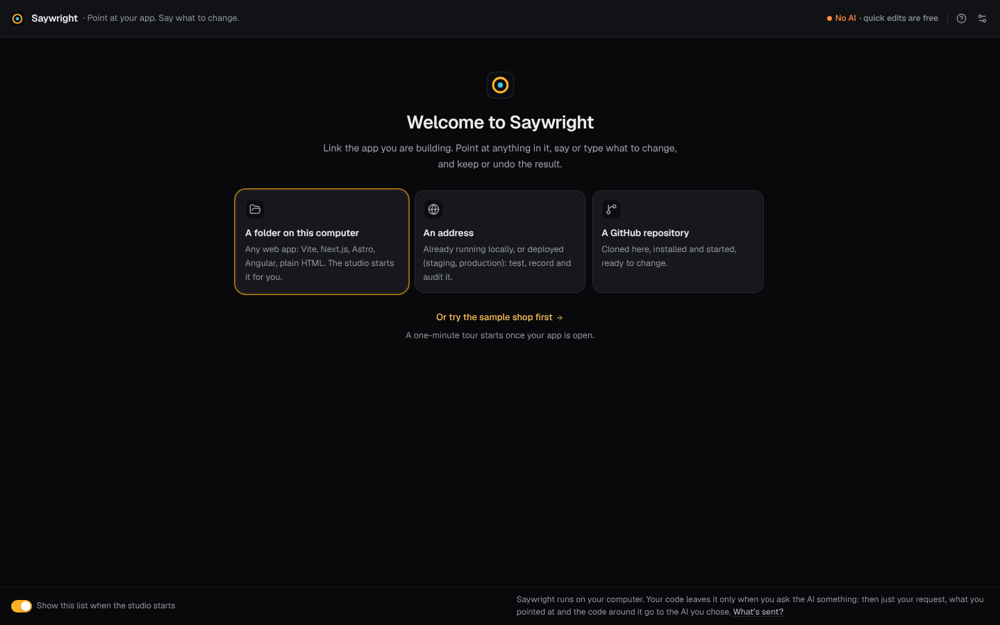
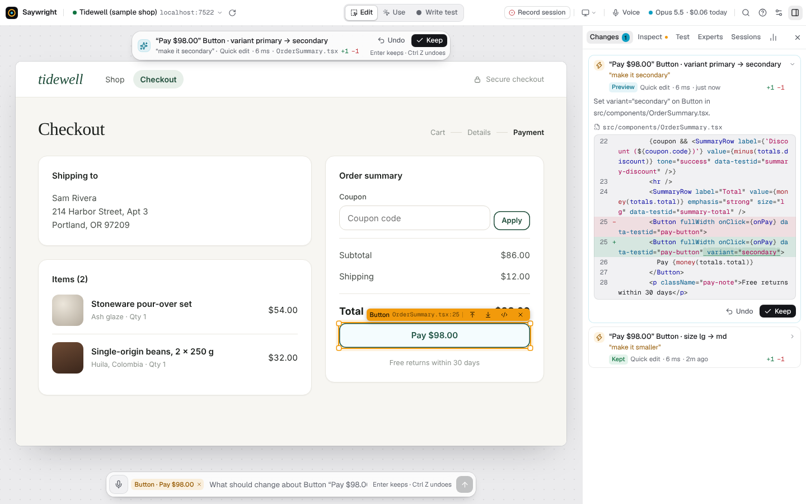
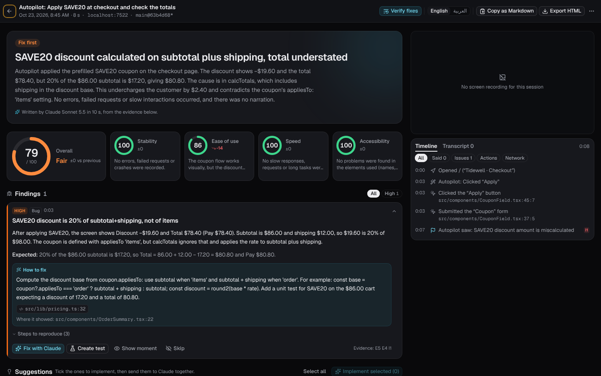
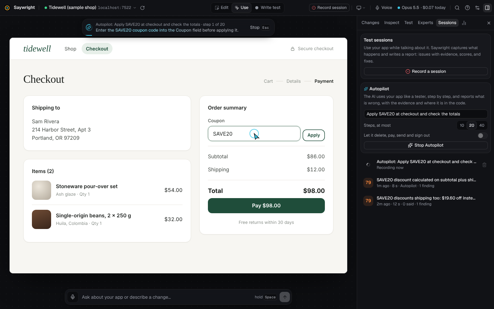
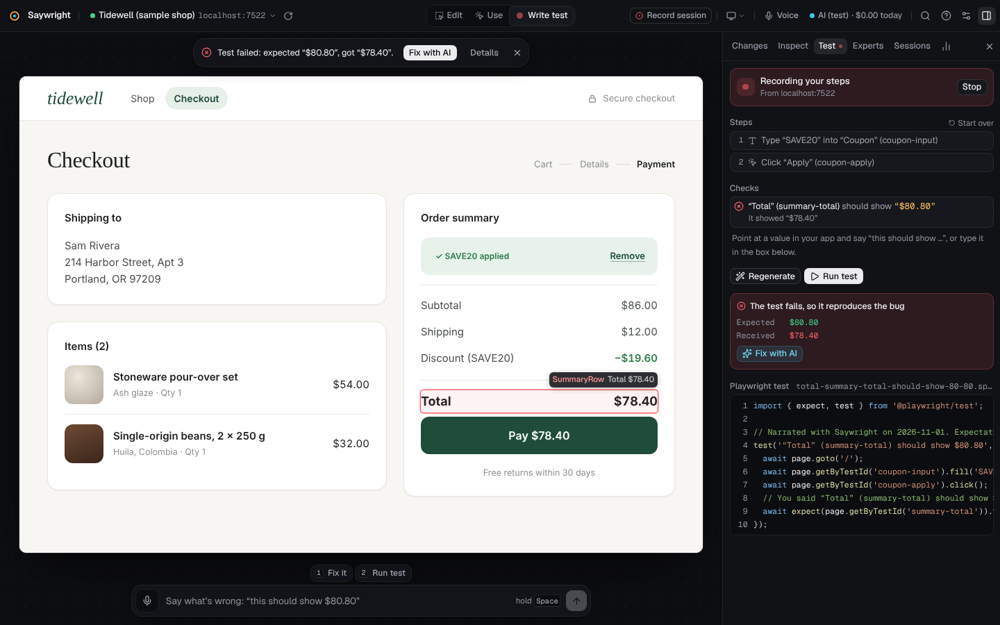
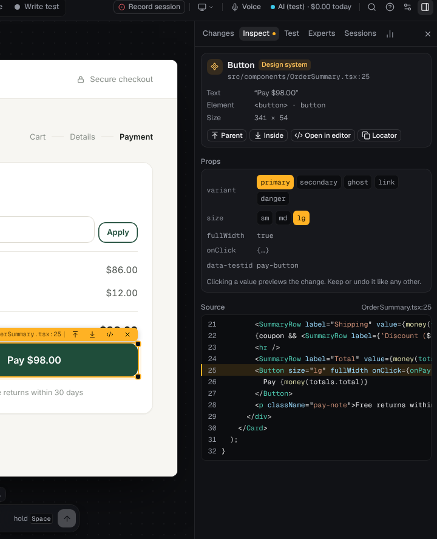
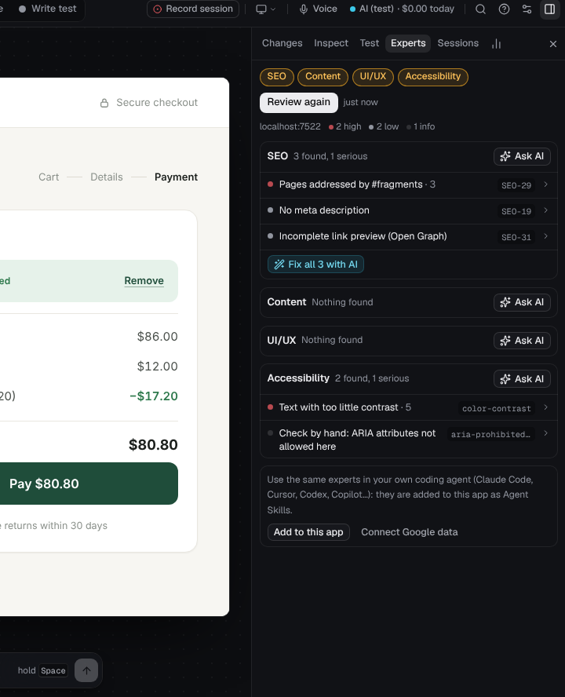

<picture>
  <source media="(prefers-color-scheme: dark)" srcset="docs/brand/lockup-on-dark.svg">
  
</picture>

<p>
  <a href="https://github.com/ahmedbakr/saywright/actions/workflows/ci.yml"></a>
  <a href="https://www.npmjs.com/package/@saywright/studio"></a>
  <a href="https://www.npmjs.com/package/@saywright/vite"></a>
  <a href="LICENSE"></a>
  
  
</p>

**Point at your app. Say what to change.** Then keep or undo the result.

Saywright is a studio that runs on your computer, next to the web app you are building. Point at anything in your running app, traced to the file and line that wrote it, and say or type what to change: “make this bigger”, “rename this to Place order”. The change appears in your code and your live app at once, as a preview you keep or undo. Record yourself using the app and get a report of what went wrong, with the evidence; let Autopilot test it; have the Experts review a page; turn what you do into a Playwright test.

<p align="center">
  <a href="docs/media/demo.mp4"></a>
</p>

[Quick start](#quick-start) · [Getting started](docs/getting-started.md) · [What you can do](#what-you-can-do) · [AI and cost](#ai-and-cost) · [Privacy and security](#privacy-and-security) · [Requirements](#requirements) · [Troubleshooting](#troubleshooting) · [Documentation](docs/README.md) · [Contributing](#contributing)

> **New here?** [Getting started](docs/getting-started.md) walks through every feature on the sample shop in about twenty minutes, with a picture of each step.

## Quick start

You need Node.js 22.18 or newer (or 24.11 or newer), and Chrome or Edge.

```bash
npx @saywright/studio
```

The studio opens at `http://localhost:7357`. Link your app, from:

- **a folder on this computer**: the studio finds the app's dev command, starts it, and follows it to its port;
- **an address**: anything running (`http://localhost:3000`) or deployed (staging, production), shown through the studio's local proxy;
- **a GitHub repository**: cloned into `~/saywright-apps`, then linked like a folder.



Or try the sample shop: it has a real bug to find, and [Getting started](docs/getting-started.md) walks through it step by step.

To set an app up from the terminal instead, connect it once, then start the studio:

```bash
npx @saywright/studio connect ./my-app
npx @saywright/studio
```

**Exact file and line for React apps on Vite.** `connect` adds the [`@saywright/vite`](packages/vite/README.md) plugin. To add it by hand:

```bash
npm install -D @saywright/vite
```

```ts
// vite.config.ts
import saywright from '@saywright/vite';

export default defineConfig({
  plugins: [saywright(), react()],
});
```

Other apps work too: Next.js and other React apps through one development-only script tag (`connect` adds it), everything else through the proxy, with no change. See [Linking your apps](docs/apps.md).

**Optional extras.** `npx @saywright/studio setup` downloads the on-device voice model (28 MB) and the speech models that transcribe Arabic and English narration (about 740 MB). `npx @saywright/studio doctor` checks your setup.

## What you can do

| | |
| --- | --- |
| **Point and change** | In **Edit** mode, click any element: the **Inspect** tab shows its component, file and line. Say or type what to change. Size, variant, text, move and remove are quick edits, made on your computer in milliseconds with no AI; anything else goes to your AI. Every change is a live preview: <kbd>Enter</kbd> keeps it, <kbd>Ctrl</kbd>+<kbd>Z</kbd> undoes it. [Using the studio](docs/guide.md) |
| **Record session** | Click **Record session**, use your app, and say what you notice, in English or Arabic. You get a report: findings with their evidence (what you said, what the screen showed, errors, failed requests, screenshots, video) and where to look in your code, scores and suggestions. It checks each result on screen, so a wrong total is found even when you say nothing. **Fix with …** and **Fix all** send findings to your AI, and **Verify fixes** plays the session again after a fix. [Sessions and reports](docs/session-report.md) |
| **Autopilot** | The AI uses your app like a tester, step by step, and writes the same kind of report. It leaves deleting, paying, sending and signing out alone unless you allow it. [Autopilot](docs/autopilot.md) |
| **Experts** | Review a page for SEO, content, UI/UX and accessibility (WCAG 2.2 with axe-core), ask an AI expert's opinion, fix findings in place, and add Google's real-user data. [Experts](docs/experts.md) |
| **Write test** | In **Write test** mode, use your app and say what it should show (“this should show $80.80”). You get a Playwright test that reproduces the bug; say “fix it”, and the AI fixes the code and runs the test again. [Write test](docs/guide.md#write-test-narrate-a-bug-get-a-playwright-test) |
| **Your AI apps** | Claude Code, Cursor, Codex, VS Code and Claude Desktop connect to the studio over MCP: they see what you point at and propose changes you keep or undo. [MCP](docs/mcp.md) |

The modes are **Edit | Use | Write test** (<kbd>E</kbd> <kbd>U</kbd> <kbd>R</kbd>): Edit to point and change, Use to click through your app as usual, Write test to turn what you do into a test.

<picture>
  <source media="(prefers-color-scheme: dark)" srcset="docs/media/studio-dark.png">
  
</picture>

<p>
  
  
</p>
<p>
  
  
  
</p>

## AI and cost

Quick edits need no AI. For everything else, connect one in **Settings → AI**:

| Option | What you need | What it costs |
| --- | --- | --- |
| **Your plan** | Claude Code, Codex or Gemini CLI, installed and signed in | Counts against your Claude, ChatGPT or Gemini plan's limits: no extra bill |
| **An API key** | An Anthropic, OpenAI or Gemini key | Billed per token by the provider |
| **Another provider** | OpenRouter, Groq, DeepSeek, Mistral, xAI, or any OpenAI-compatible address | Billed by the provider |
| **A model on your computer** | Ollama or LM Studio, running | Free, and nothing leaves your computer |

Each kind of work (changes and questions, reports and reviews, small jobs such as translations) can use a different AI. The **AI chip** in the top bar always shows who answers and what today has cost. **Settings → Usage and budget** tracks requests, tokens and cost by day, model, feature and app, with a daily and a monthly budget (by default $5 and $50) that warns you or stops requests.

**Typical costs**, measured on the sample shop in October 2026 with an Anthropic API key (Claude Opus 5.5 for changes, Claude Sonnet 5.5 for reports, reviews and Autopilot):

| | Typical cost | Typical time |
| --- | --- | --- |
| A quick edit | free | under a second |
| A change or a question | about $0.02 | 7 to 8 seconds |
| A session report | about $0.05 | 18 to 30 seconds |
| One Autopilot step | $0.001 to $0.004 | about 4 seconds |
| An expert's opinion on a page | $0.012 to $0.023 | 8 to 13 seconds |

**What is sent:** when you ask the AI something, your request, what you pointed at (its name, text, file and line), the code around it, and the files the AI reads go to the AI you chose. A model on your computer keeps all of it there. Details: [AI in Saywright](docs/ai.md).

## Privacy and security

- Saywright runs on your computer. The studio answers only on `localhost` and refuses requests from other websites; its proxy shows only the sites you link.
- Your code leaves your computer only when you ask the AI something, as above. Saywright itself sends no telemetry.
- Session narration is transcribed on your computer. Voice commands also use your browser's speech recogniser (in Chrome, on Google's servers) unless you choose *On-device* in **Settings → Voice**.
- Sessions, previews, reviews and settings stay on your computer, in `~/.saywright` and in each app's `.saywright/` folder. Typed passwords and card numbers are never recorded.
- The studio reads and writes files inside your app's folder only, links included. API keys are saved readable by you alone, and sent only to their provider.
- Opening someone else's code runs its dev command and install scripts on your computer: only open code you trust.

The threat model, every protection, and how to report a vulnerability: [SECURITY.md](SECURITY.md).

## Requirements

- **Node.js 22.18 or newer, or 24.11 or newer** (the current LTS lines), on macOS, Windows or Linux.
- **A current Chrome or Edge.** Voice uses the browser's recogniser in Chrome, Edge or Safari, or the on-device model in any browser.
- **Optional:** a microphone (voice), git (GitHub repositories), Playwright in your app (to run the tests it writes), and disk space for the speech models (about 740 MB, and 1.6 GB more for the most accurate Arabic model).

## Troubleshooting

| Problem | What to do |
| --- | --- |
| The app doesn't open | The opening card shows the command it ran and the app's output. Check the app's dev command and address in **Your apps**. |
| Clicking an element finds no source | For React on Vite, add the plugin (`npx @saywright/studio connect <folder>`). An app linked by its address alone has no code on this computer: link its folder. |
| **No AI** in the top bar | Quick edits work without one. Connect one in **Settings → AI**. |
| Voice does nothing | Allow the microphone in the browser and in your system settings. You can always type: press <kbd>/</kbd>. |
| Port 7357 is taken | The studio takes the next free port and prints it; `--port` chooses one. |

Run `npx @saywright/studio doctor` first. Everything else: [Troubleshooting](docs/troubleshooting.md).

## Documentation

[Getting started](docs/getting-started.md) · [Using the studio](docs/guide.md) · [Linking your apps](docs/apps.md) · [Sessions and reports](docs/session-report.md) · [Autopilot](docs/autopilot.md) · [Experts](docs/experts.md) · [AI](docs/ai.md) · [MCP](docs/mcp.md) · [Configuration](docs/configuration.md) · [Troubleshooting](docs/troubleshooting.md) · [Speech accuracy](docs/speech-accuracy.md) · [Changelog](CHANGELOG.md)

## Contributing

To work on Saywright itself, from a checkout:

```bash
git clone https://github.com/ahmedbakr/saywright.git
cd saywright
npm install          # also builds the Vite plugin
npm run dev          # the studio with hot reload, at http://localhost:7357 (add -- --sample for the sample shop)
npm test             # unit tests; npm run test:e2e for the end-to-end tests
```

[CONTRIBUTING.md](CONTRIBUTING.md) has the layout, every test command, and how to send a change. Bug reports and ideas are welcome as [issues](https://github.com/ahmedbakr/saywright/issues).

## License

[Apache License 2.0](LICENSE). See [NOTICE](NOTICE).
