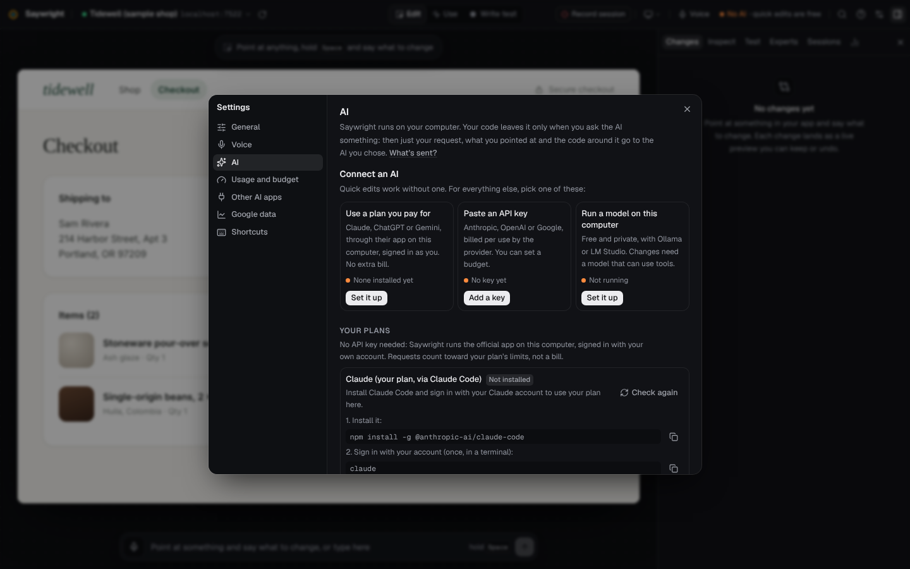
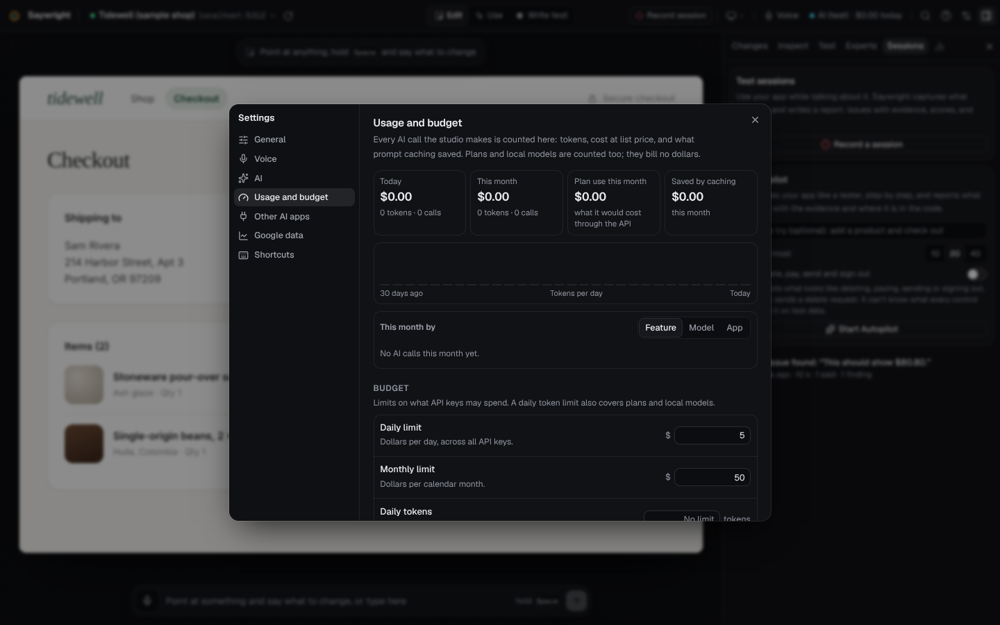

# AI in Saywright

Saywright works with the AI you already have: your Claude, ChatGPT or Gemini plan, an API key, another provider, or a model running on your own computer. Each request goes to one of them, chosen per kind of work, and every change it proposes arrives as a preview you keep or undo.

Quick edits (size, variant, text, move, remove on what you point at) need no AI at all: they are made on your computer, for free.

Everything here is in **Settings → AI** and **Settings → Usage and budget**. The **AI chip** in the top bar always shows which AI answers and what today has cost.

## Three ways to connect

### 1. Your plan, with no API key

| Plan | What Saywright runs | Set up once, in a terminal |
| --- | --- | --- |
| Claude | Claude Code | `npm install -g @anthropic-ai/claude-code`, then `claude` and sign in |
| ChatGPT | Codex CLI | `npm install -g @openai/codex`, then `codex login` |
| Gemini (your Google account) | Gemini CLI | `npm install -g @google/gemini-cli`, then `gemini` and sign in |

Saywright runs the official command-line app you are signed into, the way you would run it yourself. It never reads, copies or stores your sign-in: it asks the app whether it is signed in, starts it, and reads its answer. Usage counts against your plan's own limits, as if you had typed the request into that app.

For each request it gives the app:

- the request, the elements you pointed at with their file and line, and the code around them;
- the app's own tools for reading and searching your app's folder, and the instruction never to write files or run commands that change anything. Claude Code gets only its read, search and list tools, and Codex runs in its read-only sandbox;
- a private connection back to Saywright (MCP, with a token valid for that one request) offering a single tool, `propose_change`. The app proposes edits there; Saywright checks them and shows them as previews. Nothing is kept without your keep.

API keys in your environment are left out of these apps' environment while Saywright runs them, so a stray `ANTHROPIC_API_KEY` or `OPENAI_API_KEY` never turns plan usage into a bill.

*The Claude desktop app can't be driven by another program, but the same subscription signs in to Claude Code. The desktop app can use Saywright the other way round: see [MCP](mcp.md).*

### 2. API keys

Anthropic, OpenAI and Google Gemini. Paste a key in **Settings → AI → API keys**; **Test** checks it with one tiny request. Keys are saved in Saywright's `.env.local` (`~/.saywright/.env.local` when installed from npm, the repository's root in a checkout), readable only by you, and sent nowhere but their provider. Usage is billed by the provider, per token. Keys already in your environment are found too ([Configuration](configuration.md#ai-keys)).

### 3. Other providers, and models on your computer

- **OpenRouter, Groq, DeepSeek, Mistral, xAI**: OpenAI-compatible providers, with their key (**Settings → AI → Other providers**).
- **Any OpenAI-compatible address** (your company's gateway, vLLM, LiteLLM…). An address other than this computer must use HTTPS, so keys never travel unencrypted.
- **Ollama** and **LM Studio**: found when they run (on ports 11434 and 1234). Free and private: nothing leaves your computer. Changes need a model that can call tools.

## Which AI does what

Work comes in three kinds, and each can use a different AI:

| Work | Examples | Needs |
| --- | --- | --- |
| **Changes and questions** | “make this look like that”, “why is the total wrong?”, fixing findings | The strongest model you have |
| **Reports and reviews** | Session reports, the AI expert's opinion, Autopilot | Good judgement, structured answers |
| **Small jobs** | Translating a report into Arabic or English | Any fast model |

**Automatic** picks, for each kind, the first that is ready in this order: your plans, then API keys, then other providers, then models on your computer. To choose a connection and model per kind of work, open **Settings → AI → Advanced → Who does what**; the line under each says what is used now. **Effort** (low, medium or high), in the same place, trades speed and cost against thoroughness for every request.

**Models.** Each API key's list starts with the models Saywright has prices for (Settings → AI says when the prices were last checked), and adds the models the provider itself lists: they are asked when you save or test a key and when the studio starts, in the background, and the answer is kept in the studio's data folder. A model released after this version of Saywright can be picked the day it appears, or typed by its id under the key. A model with no known price is shown as “price unknown” (never $0), and a budget counts it at the dearest rates Saywright knows for that provider, as an estimate. Models an OpenAI-compatible provider lists under its own spelling (OpenRouter's `anthropic/claude-opus-5.5`) are recognised, with their tier and price. When another model answers for the one you picked (Claude's fallback for a declined request), the answer names the model that answered, and its use is counted under it.

## Typical costs

Measured on the sample shop in October 2026, with an Anthropic API key and automatic routing (Claude Opus 5.5 for changes and questions, Claude Sonnet 5.5 for reports, reviews and Autopilot), at medium effort. The machine was busy, so the times are on the slow side.

| What | Typical cost | Typical time |
| --- | --- | --- |
| A quick edit (size, variant, text, move, remove) | free, no AI | well under a second |
| A change or a question | about $0.02 (from $0.004 to $0.055) | 7 to 8 seconds |
| A session report, with its translation | about $0.05 | 18 to 30 seconds after Stop |
| **Fix all** on a session report | $0.11 to $0.14 | 25 to 32 seconds |
| One Autopilot step | $0.001 to $0.004 | about 4 seconds |
| An expert's opinion on a page | $0.012 to $0.023 | 8 to 13 seconds |

With your plan there is no extra bill (it counts against the plan's limits), and a model on your computer is free. Other models, your app's size and longer requests change these numbers; **Settings → Usage and budget** shows what you actually spend.

## Token-safe by design

Saywright sends as little as it can, as cheaply as it can:

- **No AI when none is needed.** Quick edits are made on your computer in milliseconds.
- **Targeted context.** The AI gets what you pointed at and the code around it instead of your whole app, and reads more only through tools, one file or search at a time. Tool results are capped at 32,000 characters, and a request stops after 10 tool rounds.
- **Prompt caching** on every provider that offers it, where a prompt is sent again: a change request's instructions and the code already read are cached between rounds, and Autopilot's instructions between steps; cached input costs a tenth or less of new input on Claude models. One-off requests (reports, reviews, translations) aren't cached, since nothing would read the cache back.
- **Structured answers.** Reports and reviews ask for JSON that matches a schema, with no tools, so there are no wasted rounds. A malformed answer gets one repair attempt, never a loop.
- **Whole changes only.** An answer that stops at the model's length limit is never applied, even when what arrived reads as a complete, smaller change: the AI is told once to send it again so that it fits, and if that is cut too the request stops with “The change was too long for one answer: ask for it in smaller parts.” Changes the AI proposes side by side in one answer land as one preview with every edit, or not at all.
- **Plans run lean.** The command-line apps run without saving a session, with only Saywright's MCP connection, and with retries capped, so a failing request stops quickly instead of retrying for minutes.
- **A budget** (below) warns before you overspend, and can stop requests outright.

## Usage and budget

**Settings → Usage and budget** shows:

- today and this month: requests, tokens (new, cached and written to the cache), and cost;
- the last 30 days as a chart;
- a breakdown by model, by feature (changes, questions, session reports, expert reviews, Autopilot, translations…) and by app;
- what caching saved.

Costs use each provider's published prices, for the model that answered. When Claude declines a request and runs it again on another model (Claude Opus and Sonnet do this), both runs are counted, each at its own model's price. Use through your plan is shown at what the same tokens would have cost through the API, for comparison: your plan pays for it, so it doesn't count toward a dollar budget, but it does count toward a daily token limit.

**Limits**: a daily and a monthly dollar budget (defaults: $5 a day, $50 a month) and an optional daily token limit. At 80% the AI chip turns amber, and red at the limit. Past it, **Warn** (the default) carries on with a notice, and **Stop** refuses new requests until the next day or month, or until you raise the limit. You can reset today's count, this month's, or clear the history. The usage log stays on your computer, in the studio's data folder.

With **Stop**, a request is sent only when the most it could cost fits in what is left. Before each request, and each step of a change, that much is set aside: what it sends, counted generously, and the longest answer it may give. A request that could go past a limit isn't sent, several running at once count each other, and when little is left a step of a change answers in less room (a report is never cut short: it isn't sent). What a request sends is counted before it goes, from its text and the size of its screenshots, at rates above what Claude's own count gives for prose, code, data, several languages and screenshots. It is still an estimate: when a model's requests turn out bigger than counted, its later ones are counted that much bigger (coming back down as they match the count again, and from scratch when you reset the count), and in a rare case a request can go slightly past a limit; then nothing more is sent. A request you stop, or one that fails after it was sent, is counted too: with what the provider said it used, else at the estimate. So is an answer whose provider reports no usage (counted at the estimate, never as free); the month's total says how many calls are estimates. Under **Stop**, a request Claude declines isn't run again on another model, because the cost of that second run can't be set aside first. A limit of $0 allows no paid request. Requests through your plan or to a model on your computer bill no dollars, so only the token limit applies to them. A model with no known price (one newer than Saywright's price table, or one a provider lists without a price) is counted at the dearest rates Saywright knows for that provider, as an estimate, so it can't be used to go past a dollar limit. The connection **Test** is a paid call like any other: it is held to the budget and counted. If the budget file is ever damaged, its last good copy is used, a **Stop** it still shows is kept, and Usage and budget says so.

## What is sent, and where

- **A change or a question** goes to the AI you chose for that kind of work, with: your words; the elements you referred to (their component name, visible text, file and line); the code around them (a whole file up to 400 lines, otherwise the lines around each place, each place apart; at most about 120,000 characters in all, very long lines cut and minified or data files left out with a note); the names of your app's files (up to 300) and the design system described in your `saywright.config.json`; and the files the AI then reads.
- **Which files it can read.** With an API key, another provider or a model on your computer, the AI reads through Saywright's own tools, which stay inside your app's folder and refuse `.env` files, `node_modules`, `.git` and links that lead outside. Binary files (images, fonts, anything that isn't text) are never shown to it and never changed. With your plan, the official app reads with its own tools, started in your app's folder, and those rules are the app's own.
- **Files stay what they are.** A change is written in the file's own encoding and with its own line ends. A file that isn't UTF-8 (a legacy page in ISO-8859-1 or Windows-1252, say) keeps every byte the change didn't touch, a file with Windows line ends stays that way, and **Undo** puts back the very bytes that were there, for quick edits too. A file that isn't UTF-8 can only take the characters its encoding has: a change that would add another (an emoji, a “€” in a Latin-1 page) is refused, and says to save the file as UTF-8 first.
- **What the AI never reads**: files that hold keys or credentials (`.env*`, `.dev.vars`, `.npmrc`, `.netrc`, `.pypirc`, private keys and certificates such as `*.pem`, `*.key`, `id_rsa*`, files named `*credentials*` or `secrets.*`, keystores, and folders such as `.aws`, `.ssh`, `.gnupg`, `.docker`), whatever the case of their names: they are refused to the AI, to MCP clients and to code search, and left out of the file list. A key written in code (an `sk_live_…` constant, a password in a database address) is sent as a placeholder such as `SAYWRIGHT_SECRET_1`; when the AI's change quotes it, the studio puts the key back, so the file keeps it.
- **Session reports** get the evidence described in [Sessions and reports](session-report.md#what-leaves-your-computer); **expert opinions** the page summary described in [Experts](experts.md#what-is-sent-and-where); **Autopilot** a short description of each page it is on ([Autopilot](autopilot.md#what-the-ai-sees-and-what-it-costs)).
- **A model on your computer**: nothing leaves it.
- **Keys** go only to their own provider.

## Other AI apps

Saywright is also an MCP server: Claude Code, Cursor, Codex, VS Code and Claude Desktop can see what you point at and propose changes you keep or undo. Set it up in **Settings → Other AI apps**: see [MCP](mcp.md).

## Troubleshooting

| Problem | What to do |
| --- | --- |
| A plan shows *Not installed* | Install its command-line app (Settings → AI shows the command), then **Check again**. |
| A plan shows *Sign in needed* | Run `claude`, `codex login` or `gemini` once in a terminal and sign in. |
| “Your plan’s limit is reached” | Wait for the plan's limit to reset, or route the work to an API key or a local model in **Settings → AI → Advanced**. |
| “Couldn’t reach …” | The provider or your network is down. Saywright stops quickly instead of retrying for minutes; try again, or route the work elsewhere. |
| “… stopped answering: nothing came for 90 seconds” | Answers are streamed, so a long one (a local model writing a report) can take as long as it needs; a provider that sends nothing for 90 seconds is given up on. Try again; for a local model, check it is still running. |
| “The connection to … was lost while it was answering” | Your network dropped (or the computer slept) in mid-answer. Try again. |
| “… took longer than five minutes to answer” | A server that can't stream (some local servers can't with tools) gets five minutes per answer. Ask for something smaller, or use a faster model. |
| “… answered with a web page, not as an API” | The provider's address is wrong: for an OpenAI-compatible server it usually ends in `/v1`. Fix it under that connection in **Settings → AI**. |
| “… wrote its tool calls as text instead of making them” | That model (often a small local one) can't call tools, so it can't change code. Pick another model for changes. |
| “Your Anthropic account is out of credit” | Add credit in the Anthropic Console, or route the work to another connection. A rate limit or a server problem is tried once more by itself before you see it. |
| Requests are refused with a budget message | The budget is set to **Stop** and a limit is reached: raise it or reset the count in **Settings → Usage and budget**. |
| “Claude declined this request” | Rephrase it. With the budget set to **Stop**, Claude doesn't try another model for it; with **Warn** it does. |
| “… isn’t saved as UTF-8, and this change adds a character its encoding can’t hold” | Nothing was written. Save that file as UTF-8 in your editor (“Save with encoding”), then ask again. |
| “The change was too long for one answer” | Ask for it in smaller parts: one file or one behaviour at a time. Nothing was changed. |
| An answer ends with “(Cut short: …)” | The model reached its length limit in mid-answer. Ask a narrower question; when the note names your budget, raise the limit in **Settings → Usage and budget**. |
| An OpenAI-compatible provider doesn't list models | Add the model's name by hand under that connection. |
| A local model makes no changes | Changes need a model that can call tools; most recent ones can. |
