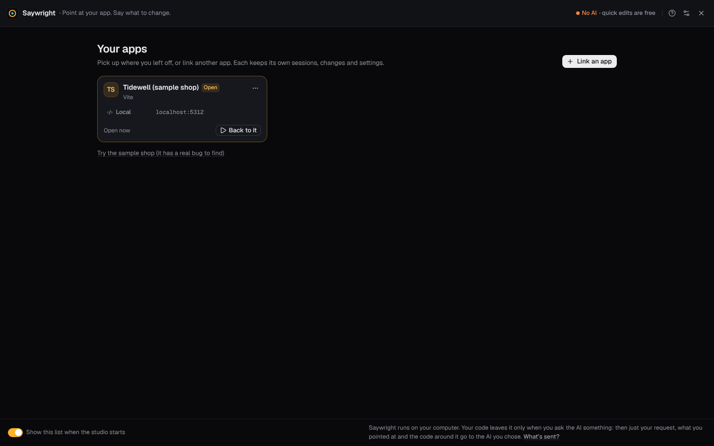
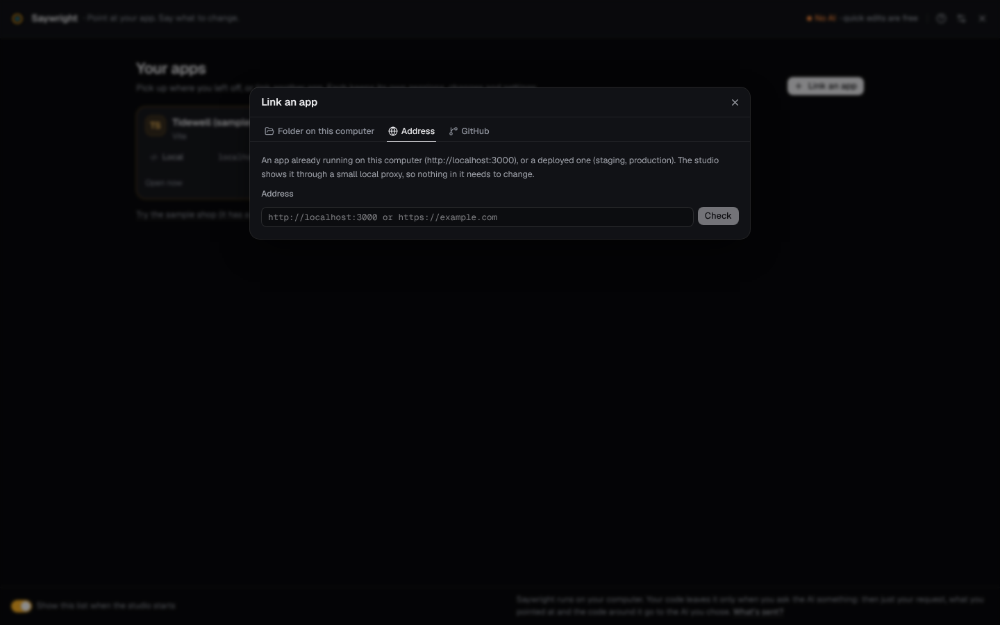

# Linking your apps

Saywright works on a web app you link to it. It opens on **Your apps**, the apps you have linked, most recent first. **Link an app** adds one, and the sample shop, which has a real bug to find, is a click away from the same screen.



## Three ways to link an app

| Link | What the studio does |
| --- | --- |
| **A folder on this computer** | Reads the app's framework, its dev command, its usual port and its package manager. When you open the app, the studio runs that command, waits for the dev server (up to 90 seconds), and follows it if it starts on another port. The address it shows is the one on the dev server's “Local” line; a command that starts several servers (an API, then the web server) is given a few seconds to print that line, and an address that answers with something that is not a page (an API's 404 or JSON) is never taken for the app. A “Local” line printed later, while the app runs, moves the studio to that address. A folder of plain HTML is served by the studio itself; a PHP app is started with PHP's own server (`php -S`, or `php artisan serve` for Laravel), which you can change. In a monorepo, it lists the apps inside the folder to pick from. |
| **An address** | Shows any running site: `http://localhost:3000`, a staging server or production. It is shown through the studio's local [proxy](#the-proxy), so nothing in the site needs to change. |
| **A GitHub repository** | Clones it into `~/saywright-apps` (**Clone into** changes the folder), using the GitHub CLI when it is signed in, so private repositories work too, or git with the access it already has. Then it is linked like a folder. |



An app linked by its address alone can be used, recorded, tested by Autopilot and reviewed by the Experts, but the studio has no code to change. **Link its folder…** (offered when you ask for a change) gives that same app its code: its addresses stay, and what the studio kept for it (sessions, reports) moves to the folder's `.saywright`.

**Opening someone else's code runs it.** Opening an app runs its dev command, and installing its dependencies runs its install scripts, with your permissions. When you link a cloned repository, or a folder whose dependencies aren't installed, the studio says so. Only open code you trust.

## How elements are traced to your code

Pointing at an element tells the studio which code wrote it. How exactly depends on the app:

| Your app | How the studio finds the code | Quick edits |
| --- | --- | --- |
| **Vite + React** with [`@saywright/vite`](../packages/vite/README.md) | The exact file, line and column of each JSX element, added by the plugin while you develop | Yes |
| **Other React apps** (Next.js, Create React App, webpack) | React's development information, mapped back to your files through source maps. Needs one development-only script tag (`connect` adds it), or the proxy. | Yes |
| **Vue, Svelte, Astro** | The framework's own development information (for Vue, the component's file even where its words come from data) | No: the AI makes the changes |
| **Plain HTML, server templates (PHP, Django, Rails…), anything else** | A search of your code for what identifies the element: its id or test id, then its name, label or link, then its text | No: the AI makes the changes |

Quick edits are the changes made on your computer without an AI (size, variant, text, move, remove). They change React components (JSX); everything else goes to your AI.

## Connect from the terminal

`connect` sets an app up once, from a terminal, and links it:

```bash
npx @saywright/studio connect ./my-app
npx @saywright/studio
```

(In a checkout of this repository: `npm run connect -- ./my-app`, then `npm run dev`.)

What it adds depends on the app:

| App | What `connect` changes |
| --- | --- |
| **Vite** (including Vue, React Router and Remix on Vite) | Installs `@saywright/vite` with the app's own package manager, then adds `saywright()` to the plugins in the Vite config, in the config's own style. The plugin runs on the dev server only: nothing of it is built. Where the config's plugins can't be found for sure (a list kept in a variable, a CommonJS `vite.config.cjs`: the plugin needs an ES module config), it changes nothing and prints the lines to add by hand. |
| **Next.js** | Adds one development-only script tag to the root layout (`app/layout`) or `pages/_document`. |
| **Other apps with an HTML page** (Create React App, webpack, Angular…) | Adds the script tag at the top of the page's `<head>` (`public/index.html`, `index.html` or `src/index.html`), so session recording starts before the app's own scripts. This tag isn't removed from production builds: `connect` says so, and the comment above it says to remove it before you deploy. Anywhere the studio isn't running, it fails to load and the page carries on. |
| **SvelteKit, Astro, Nuxt, Docusaurus** and others without an HTML page | Nothing: the studio shows them through its proxy. |
| **A folder of plain HTML** (with or without a `package.json`), **a PHP app** | Nothing: the studio shows every page through its proxy. |
| **A monorepo's top folder** | Nothing: it lists the apps inside, to connect one of them. |

If the studio is running, it links the app at once: open it from **Your apps**. Otherwise the app opens first the next time the studio starts; connect several before then and each is linked, the last one opening first. `--dry-run` shows what it would change, with the lines it would add, and changes nothing; the other options (`--url`, `--start`, `--no-start`, `--studio`) are in [Configuration](configuration.md#saywright-connect).

To disconnect an app, remove it from the app list (its code, sessions and reports stay where they are), and remove `saywright()` from its Vite config or the `saywright.js` script tag.

Moved the studio to another port? Run `connect` again: it points the app's script tag at the studio's current address.

## The plugin, by hand

For a Vite + React app you can add the plugin yourself instead of running `connect`:

```bash
npm install -D @saywright/vite
```

```ts
// vite.config.ts
import { defineConfig } from 'vite';
import react from '@vitejs/plugin-react';
import saywright from '@saywright/vite';

export default defineConfig({
  plugins: [saywright(), react()],
});
```

It runs on the development server only. Its options are in its [README](../packages/vite/README.md).

## The proxy

An app linked by its address, or one without the plugin or the script tag, is shown through a small proxy on your computer. The proxy:

- gives each app address its own port on `localhost` (from 5281), the same one each time, so each app keeps its own cookies and storage;
- adds the studio's script first in each page's `<head>`, which makes the page pointable and recordable;
- removes the headers that would stop the page from showing inside the studio (framing rules and the Content Security Policy) while it is shown there;
- keeps redirects within the site inside the proxy, and fetches pages of that site only;
- passes on the app's requests to another port of this computer (its API, at `http://localhost:5010` say), from the app's own address, so the API's CORS rules work as they do in the app's own tab: a request the API's rules would refuse there is refused here too, and the app's cookies go only with requests made with credentials (`credentials: 'include'`, `withCredentials`). This covers `fetch`, `XMLHttpRequest`, `EventSource`, `WebSocket` and `sendBeacon`. Only the app's own page can ask for that.

Not covered: an image, a stylesheet or a link that points at that API's address (``, a sign-out link to the API). The browser loads those itself, at the real address, without the cookies the app has through the proxy: the image doesn't show, the link leaves the proxy. Load such things through `fetch`, serve them from the app's own address (a dev server proxy such as Vite's `server.proxy`), or connect the app so the studio shows it at its own address.

What can't work through any proxy: signing in on another site that returns to the real address (OAuth, single sign-on), bot checks, API keys locked to the real domain, an API on another site that allows only the app's real address, and service workers (they are switched off while the studio shows the site). For an app on this computer, connecting it (`npx @saywright/studio connect <folder>`) avoids all of these: the studio then shows it at its own address.

## Several addresses, switching, removing

- An app can have several addresses: **Add an address** in its menu (staging, production…), and choose one when you open it. The production address is the one Google's real-user data is looked up for ([Experts](experts.md#google-data)).
- Switch apps from the app menu at the top left. A preview waiting for keep or undo is settled first.
- **Show this list when the studio starts** turns the app list off for people who work on one app.
- Each app keeps its own sessions, changes, reviews and settings: see [Data folders](configuration.md#data-folders).

## Monorepos

Link (or `connect`) the app's own folder, not the workspace's top. The studio finds Vite, the installed dependencies and the package manager up to the top of the workspace, and an app whose dependencies are installed at the top isn't asked to install them again.

The studio starts the app from the folder you linked and keeps its `.saywright` folder there, but its code goes as far as the workspace: an element written in another package the workspace lists (a shared component library, say) is traced to its file there (`../packages/ui/Button.tsx`), and quick edits and the AI can read and change it. Nothing outside the workspace's top folder, or in `node_modules`, is read or changed.

## Describe your design system: `saywright.config.json`

Components built with `cva(...)` (class-variance-authority, used by shadcn/ui and many others) are understood as they are: the Inspector shows their variants and sizes, and “make this bigger”, “make it outline” or “make it red” are quick edits, with no setup.

For other components, add a `saywright.config.json` at the app's root. The sample shop's is a full example ([`apps/shop/saywright.config.json`](../apps/shop/saywright.config.json)):

```json
{
  "name": "Tidewell shop",
  "components": {
    "Button": {
      "file": "src/ds/Button.tsx",
      "text": "children",
      "props": {
        "variant": { "values": ["primary", "secondary", "ghost", "link", "danger"], "default": "primary" },
        "size": { "values": ["sm", "md", "lg"], "default": "md", "ordered": true }
      }
    }
  },
  "synonyms": { "red": ["danger"], "subtle": ["ghost", "muted"] },
  "guidelines": "Change UI through design-system components and their props. Never hardcode colors or pixel values."
}
```

| Field | What it does |
| --- | --- |
| `components.<Name>.file` | Where the component is defined. |
| `components.<Name>.text` | The prop that holds its visible text (`children`, `label`…), for “rename this to …”. |
| `components.<Name>.props` | Each prop's allowed `values` and its `default`. `"ordered": true` means the values go from small to large, so “bigger” and “smaller” step through them. |
| `synonyms` | Words people say, and the values they mean (“red” → `danger`). Common ones are built in. |
| `guidelines` | Rules the AI is given with every request for this app. |
| `name` | The app's name in the studio. |
