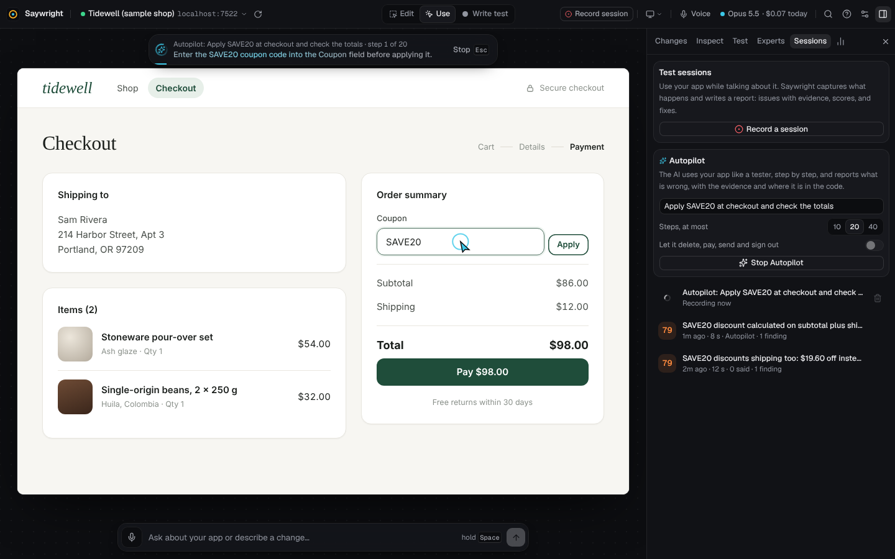

# Autopilot

Autopilot lets the AI use your app the way a tester would: it reads the page, clicks, types and moves around, and notes
anything that looks wrong. It ends in an ordinary session report, so what it found comes with the same evidence as
a session you recorded yourself: every step, failed requests, console errors and screenshots, each finding tied to the
code behind it.

Use it when you want a second pair of eyes on a flow before you ship, after a big change, or on a part of the app you
haven't clicked through in a while. It needs an AI connection (Settings → AI).

## Run it

1. Open your app in the studio and go to **Sessions** in the side panel.
2. In the **Autopilot** card, say what to try, in plain words: *Apply the SAVE20 coupon at checkout and check the
   totals*. Leave it empty to let it explore the app's main features.
3. Under **Steps, at most**, pick 10, 20 or 40. Each step is one look at the page and one action.
4. Leave **Let it delete, pay, send and sign out** off unless you mean it (see [Safety](#safety)).
5. Press **Start Autopilot**.

The studio switches to Use mode and shows what Autopilot is doing, step by step, with the element it is about to use
highlighted. Press **Stop Autopilot** or <kbd>Esc</kbd> at any time: a stopped run still ends in its report.

## What you get

When the run ends, its report opens by itself. It is a normal session, listed under **Sessions**:

- **Timeline**: each step in words (*Autopilot: Typed “SAVE20” into “Coupon”*, *Autopilot: Clicked “Apply”*), with
  why it took it, between the requests, errors and screenshots of the moment.
- **Findings**: what Autopilot saw that looked wrong, each with what it expected and what happened, a severity, and
  the file and line of the element involved (*SAVE20 takes 20% off shipping too — expected a discount of 20% of the
  items only*). Technical problems it ran into, such as failed requests, are found the same way as in any session.
- **Steps you can reuse**: replay the run after a fix to check it, or turn it into a Playwright test.

From the report you can send findings to the AI to fix, set aside the ones that aren't problems, and export the report.

## Safety

- **Your app, your browser.** Autopilot drives the app inside the studio's frame on your computer. It doesn't run
  anywhere else, and it only goes to pages of the app you opened.
- **Risky controls are off limits by default.** Buttons and links whose names say they delete, pay, buy, place an
  order, send, transfer, publish, deploy or sign out (in English and Arabic) are skipped and noted in the timeline. Turn
  on **Let it delete, pay, send and sign out** only on test data.
- **Passwords stay out.** Password fields are described to the AI as filled or empty, never with their value.
- **Each run is bounded.** It stops at the step limit, when it decides it is done, after three steps in a row that
  didn't work, or when you stop it.

Use test accounts and a development or staging back end, as you would for any automated test.

## What the AI sees and what it costs

Each step sends the AI a compact description of the page: its address and title, the headings, up to 1,500 characters
of its visible text, up to 60 controls with their names, roles and values, what the app reported since the last step
(errors, failed requests), and the steps taken so far. No source code is sent during the run.

Autopilot uses the AI set for *Reports and reviews* in **Settings → AI**, with a small answer size per step, so a
20-step run makes about 20 short AI calls, then its report is written. Measured on the sample shop with an Anthropic API
key, a step cost $0.001 to $0.004 and took about 4 seconds ([typical costs](ai.md#typical-costs)). What it spends shows
under **Autopilot** in **Settings → Usage and budget**, and your budget applies: with a budget set to stop at its limit,
a run stops there too.

## Tips

- Be specific when you have a flow in mind: the goal steers the first steps, and Autopilot then tries what tends to
  break (empty or invalid input, going back, doing a thing twice).
- Start small (10 steps) on a new app to see how it finds its way, then give it more room.
- Pages behind a login: sign in first in Use mode, then start Autopilot from the page you want tested.
- If it keeps missing a control, point at it in Edit mode: if Saywright can't trace it, the AI can't name it either.
