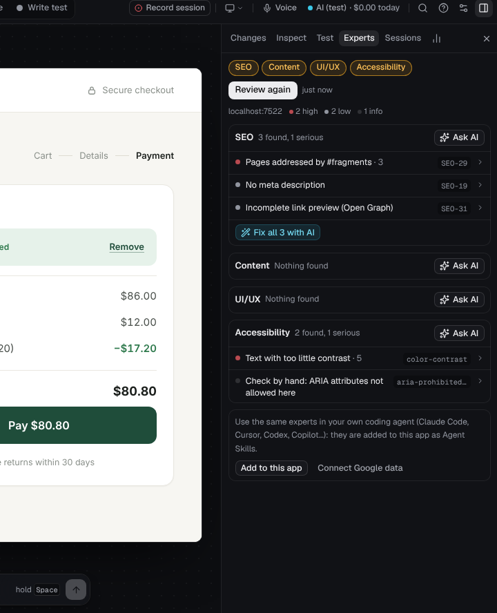

# Experts: SEO, content, UI/UX and accessibility

The **Experts** tab reviews the page your app is showing, the way four specialists would, and fixes what they find in your code:

| Expert | Judges by |
| --- | --- |
| **SEO** | Google Search Central: indexing, titles and snippets, canonical URLs, links, images, structured data, hreflang, mobile, Core Web Vitals |
| **Content** | GOV.UK content and design guidance, W3C cognitive accessibility (COGA), W3C internationalization and ALREQ for Arabic and right-to-left text |
| **UI/UX** | Nielsen's heuristics, WCAG 2.2 target size and reflow, GOV.UK and web.dev form guidance, layout stability |
| **Accessibility** | WCAG 2.2 A and AA with [axe-core](https://github.com/dequelabs/axe-core) 4.14 (target size included) |

Rules are as of October 2026. Each finding names its rule and links to the source.

## Using it

1. Open the page you want reviewed in the studio (**Use** mode to get there), then the **Experts** tab.
2. Choose the experts (all four by default) and click **Review this page**. The checks run inside the page, in one pass: about half a second on a typical page.
3. Findings are listed per expert, most severe first: **blocker**, **high**, **medium**, **low**, then **info** (worth knowing, nothing to fix). Click one to see the evidence, the fix, the WCAG criteria it fails and the rule's source.
4. **Show** selects the element a finding is about, scrolled into view, so you can see it, inspect it, or say what to change about it.
5. **Fix with …** sends the finding, its evidence and its elements (with their file and line) to the AI; the fix arrives as a preview to keep or undo. **Fix all** sends every finding an expert has, in one request.
6. **Review again** after fixing: what you fixed is gone from the list.

Reviews are saved per page in the open app's own data, so each linked app keeps its own. A page is known by its address without the `?query` or `#fragment` part, so two routes that differ only after `#` share one review.

### Ask the AI expert

Checks are exact, but they can't judge whether a title is good or a sentence is clear. **Ask …** on an expert sends it the page (title, description, headings, the main text, form fields and buttons, the key elements with their place in the code, speed, and Google's real-user data when connected) and that expert's findings. It answers with:

- a short summary of the page from that expert's point of view;
- a verdict on every check: **Confirmed** (it matters here) or **Dismissed** (harmless here), with why. Dismissed findings are dimmed and left out of **Fix all**;
- up to eight findings of its own, marked with ✦, tied to an element when there is one, with a rewrite (before → after) for wording.

It uses the AI set for **Reports and reviews** in Settings → AI, with a structured answer and no tools, so one review is one request: $0.012 to $0.023 per expert on the sample shop with an Anthropic API key ([typical costs](ai.md#typical-costs)). It only sees the summary above, so treat its verdicts as a second opinion: look at a dismissed finding before you ignore it.

## What is checked

### SEO

| Rule | Finding | Severity |
| --- | --- | --- |
| SEO-01 | The page returns an error status (4xx: blocker; 5xx: high), or didn't answer | blocker / high |
| SEO-02 | Redirects: a chain of hops, temporary redirects (302/307) | info to blocker, by length |
| SEO-04 | The HTML is over 2 MB (Googlebot reads the first 2 MB) | high |
| SEO-05 | `noindex` in the robots meta tag or the `X-Robots-Tag` header | blocker |
| SEO-07 | Snippets turned off (`nosnippet`, `max-snippet:0`), which also keeps the page out of AI Overviews as a source | medium |
| SEO-08 | robots.txt answers with a server error, is over 500 KiB, or lists sitemaps by relative URL | blocker / medium / low |
| SEO-09 | robots.txt blocks this page (Google's matching: longest rule wins, `Allow` wins a tie, `*` and `$`) | blocker |
| SEO-10, SEO-11 | No sitemap, a sitemap that isn't one, over 50,000 URLs, or one that doesn't list this page | medium / low |
| SEO-13 | Canonical problems: more than one, outside `<head>`, relative, or carrying attributes that void it | high / low |
| SEO-16, SEO-17 | No title, or a placeholder title (“Home”, “Vite + React”…) | high / medium |
| SEO-18 | A title long enough to be cut off in results (no length limit exists; only order matters) | info |
| SEO-19 | No meta description | low |
| SEO-20 | No headings at all | low |
| SEO-21 | Images without alt text; large content images set as CSS backgrounds | medium / info |
| SEO-22 | Links Google can't follow (no `href`, `#`, `javascript:`) | medium |
| SEO-23 | Link text that says nothing (“click here”, “read more”, “اضغط هنا”…) | low |
| SEO-25 | hreflang codes that aren't languages, or alternates with relative URLs | high / medium |
| SEO-28 | No mobile viewport | high |
| SEO-29 | Routes in `#fragments` (`/#/about`): one URL to Google | high |
| SEO-30 | Underscores in the URL | info |
| SEO-31 | Incomplete link previews (Open Graph), or a relative preview image | low |
| SEO-34 | Slow largest paint or layout shifts measured in this browser (on a dev server, slow paint is only noted) | medium / high |
| SEO-37, SEO-38 | Structured data that doesn't parse; Product, BreadcrumbList or LocalBusiness without their required fields | high / medium |
| SEO-40 | FAQPage or HowTo markup: those rich results are retired, the markup is harmless | info |

The crawl (status, redirects, `X-Robots-Tag`, HTML size) runs on every page; robots.txt and the sitemap are checked only on public addresses, since a site on your computer has neither.

Not reported, on purpose, because Google doesn't use them: the number of H1 headings, title or description length limits, keyword density, `meta keywords`, and `llms.txt`.

### Content

| Rule | Finding | Severity |
| --- | --- | --- |
| CNT-01 | Reading grade above 9, or above 12 (Flesch–Kincaid, English pages over 100 words) | low / medium |
| CNT-02 | Sentences averaging over 25 words; paragraphs over 120 words | low |
| CNT-06 | Buttons that don't say what they do (“Submit”, “OK”, “Continue”, “إرسال”…) | low |
| CNT-07 | Error messages that don't help (“This field is required”, “Something went wrong”…) | medium |
| RTL-01, RTL-02 | A mostly Arabic page without `lang="ar"` and `dir="rtl"` on `<html>`, or with the direction set only in CSS | high |
| RTL-06 | A right-to-left page whose title starts with a Latin word | info |
| RTL-08 | Two digit systems (0–9 and ٠–٩) on one page | low |
| RTL-09 | Letter-spacing on Arabic text, which breaks the joins between letters | medium |

### UI/UX

| Rule | Finding | Severity |
| --- | --- | --- |
| UX-01 | Controls under 24×24 px with a neighbour too close (WCAG 2.5.8) | medium |
| UX-06 | Things that react to clicks but aren't buttons or links | medium |
| UX-07 | Fields labelled only by a placeholder | medium |
| UX-08 | Name, email, phone, address or card fields without `autocomplete`; `type="number"` for cards, phones and codes | medium / low |
| UX-09 | Pasting blocked (breaks password managers) | high |
| UX-14 | More than two filled, primary-looking buttons in the first screen | low |
| UX-16 | Images without a width and height (the page jumps while they load) | low |
| UX-17 | Zoom turned off; sideways scrolling on a narrow screen | high / medium |

### Accessibility

Every axe-core rule tagged WCAG 2.0, 2.1 and 2.2 A and AA, plus its best practices and target size, with axe's impact as the severity (critical: blocker, serious: high, moderate: medium, minor: low). Results axe can't decide on its own are listed as **Check by hand** (info). The most common rules have plain titles (“Text with too little contrast”, “Form fields without a label”); each finding lists the WCAG criteria it fails and links to Deque's explanation.

On a big page the checks run in steps, so your app and the studio keep responding, and the review shows how far it has got. Long runs of like items (more than 30 rows or cards side by side) are checked by their first five; rules about a list or table as a whole still see all of it, and the review says how many items were left out.

axe-core is loaded into the page only for a review, from the studio. Pages shown through the studio's proxy have their Content Security Policy removed (the studio's bridge needs that too), so it loads there as well; on a page served with a strict policy any other way, the review says the accessibility checks couldn't run.

## The experts in your own coding agent

**Add to this app** (at the bottom of the Experts tab) writes the four experts into your app as [Agent Skills](https://agentskills.io): `.agents/skills/<name>/SKILL.md`, and `.claude/skills/<name>/SKILL.md` when your app already has a `.claude` folder. Claude Code, Codex, Cursor, GitHub Copilot and other agents that read skills then review and fix pages with the same rules: `seo-audit`, `content-review`, `ux-review` and `a11y-audit`. Pressing it again brings the files the studio wrote up to date; a skill of the same name that you wrote yourself is left as it is, and the studio tells you which file it left.

## Google data

Real-user numbers next to a review, for the page's public address. Set up in **Settings → Google data**, or from **Connect Google data** in the Experts tab.

| Data | What you see | What it needs |
| --- | --- | --- |
| **Chrome UX Report** | Largest contentful paint, interaction to next paint and layout shift for real Chrome users on phones, 75th percentile over 28 days; the whole site's when the page has too little traffic | A Google Cloud API key with the Chrome UX Report API turned on (free) |
| **Search Console** | The page's clicks, impressions, click-through rate, average position and top queries over 28 days | A service account added to your Search Console property (Restricted is enough) |
| **Google Analytics 4** | The page's views, users and engagement over 28 days | The same service account added to your GA4 property (Viewer) |

To set up the service account:

1. In Google Cloud, create a service account and add a JSON key to it.
2. Turn on the Search Console API and the Google Analytics Data API in the same project.
3. Add the service account's email as a user: in Search Console (Settings → Users and permissions, Restricted) and in Google Analytics (Admin → Property access management, Viewer).
4. In **Settings → Google data**, choose the key file (or paste it), then for each app enter its Search Console property (`sc-domain:example.com` or a URL prefix like `https://www.example.com/`) and its GA4 property ID (numbers, from Admin → Property details). **Test** checks all three.

Data is looked up for the page's public address: the page itself when the app is a public site, or the same path on the app's production address when you are working on a copy on your computer (add the production address to the app in the app list).

The API key is saved as `PAGESPEED_API_KEY` in Saywright's `.env.local`, and the service account key in the studio's data folder (`~/.saywright` when installed from npm: see [Data folders](configuration.md#data-folders)), both readable only by you. Only the key's email and private key are kept. Saywright asks Google for read-only access, and sends Google nothing but the page's public address.

## What is sent, and where

- The checks run in your browser. Nothing leaves your computer for them, except the crawl of a public page (the page, its robots.txt and its sitemap, fetched from your computer like a browser would).
- **Ask …** sends the page summary described above to the AI you chose for reviews; at most the first 3,000 characters of the page's main text are included.
- Google data: requests to Google's APIs for the page's public address.
