# Getting started

A walk through Saywright on its sample shop, one feature at a time, with what you should see at each step. It takes about twenty minutes. At the end you link your own app.

The sample shop has a real bug, there on purpose: the coupon `SAVE20` should take 20% off the items only, but it also takes 20% off shipping. On the way you point at it, ask about it, turn it into a test, record a session that finds it, fix it, and check the fix.

- [Before you start](#before-you-start)
- [1. Start the studio](#1-start-the-studio)
- [2. Open the sample shop](#2-open-the-sample-shop)
- [3. Find your way around](#3-find-your-way-around)
- [4. Point at something](#4-point-at-something)
- [5. Change it, then keep or undo](#5-change-it-then-keep-or-undo)
- [6. Point at two things](#6-point-at-two-things)
- [7. Ask a question](#7-ask-a-question)
- [8. Turn the bug into a test](#8-turn-the-bug-into-a-test)
- [9. Record a session](#9-record-a-session)
- [10. Read the report](#10-read-the-report)
- [11. Fix it, then verify the fix](#11-fix-it-then-verify-the-fix)
- [12. Let Autopilot test the shop](#12-let-autopilot-test-the-shop)
- [13. Review the page with the Experts](#13-review-the-page-with-the-experts)
- [14. Settings worth knowing](#14-settings-worth-knowing)
- [15. Link your own app](#15-link-your-own-app)

## Before you start

- **Node.js 22 (22.18 or newer) or Node.js 24 and later (24.11 or newer)**. Check with `node --version`; get it from [nodejs.org](https://nodejs.org).
- **Chrome or Edge**, current.
- **An AI, for the steps marked _needs an AI_.** Pointing, quick edits, the Experts' checks and recording sessions work without one. For the rest, connect one in **Settings → AI** ([step 14](#14-settings-worth-knowing)): the Claude, ChatGPT or Gemini plan you already pay for, an API key, or a free model on your computer. A session report written without an AI still lists errors, failed requests, slow moments and what you said, but it can't spot a wrong total on the screen by itself.

The pictures on this page were taken with the studio's built-in test AI, so its top bar says **AI (test)**: yours names the AI you connected, or says **No AI**.

## 1. Start the studio

```bash
npx @saywright/studio
```

The studio opens in your browser at `http://localhost:7357`. The first time, it welcomes you with the three ways to link an app.

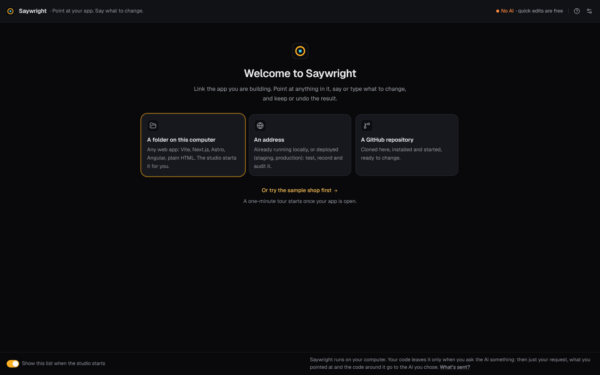

> Working on Saywright itself? From a checkout: `npm install`, then `npm run dev` ([CONTRIBUTING.md](../CONTRIBUTING.md)).

## 2. Open the sample shop

Click **Open the sample shop**. The first time, the studio copies the shop to `~/.saywright/sample-shop` and installs what it needs (about a minute, with npm's output on screen); after that it opens in seconds. The shop's checkout page shows in the middle of the studio, and a one-minute tour starts in the corner. Follow it, or click **Skip tour**: **Help** (<kbd>?</kbd>) brings it back any time.

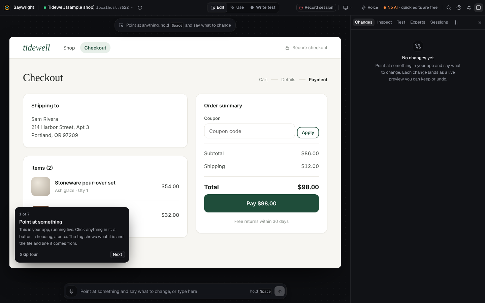

## 3. Find your way around

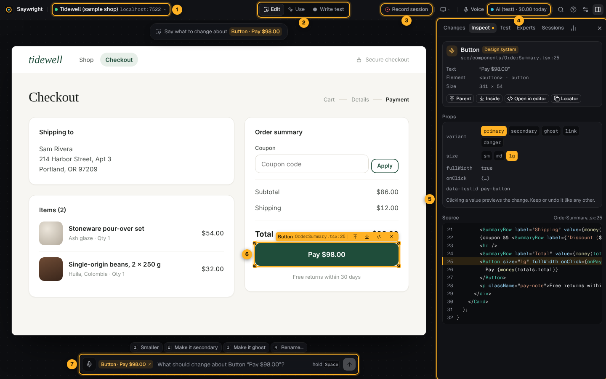

1. **The app menu.** Switch apps, see **All apps**, or **Link an app**.
2. **The modes.** **Edit** (<kbd>E</kbd>) to point at things and change them, **Use** (<kbd>U</kbd>) to click through your app as usual, **Write test** (<kbd>R</kbd>) to turn what you do into a Playwright test.
3. **Record session.** Record yourself using the app, and get a report.
4. **The AI chip.** Who answers, and what today has cost. “No AI · quick edits are free” until you connect one.
5. **The side panel** (<kbd>\\</kbd> shows or hides it): **Changes**, **Inspect**, **Test**, **Experts**, **Sessions**, and **Stats** (the chart icon).
6. **Your app**, live. In Edit mode, what you point at is outlined, with a tag naming its component, file and line.
7. **The command bar.** Hold <kbd>Space</kbd> and talk, or type here. Suggestions for what is selected show above it: <kbd>1</kbd> to <kbd>4</kbd> run them.

## 4. Point at something

In **Edit** mode, click the **Pay $98.00** button.

**What you see:** the button is outlined, and its tag says `Button` and `OrderSummary.tsx:25`, the file and line that wrote it. The **Inspect** tab shows the component, its props (click a value to try it), and its source with the line marked.

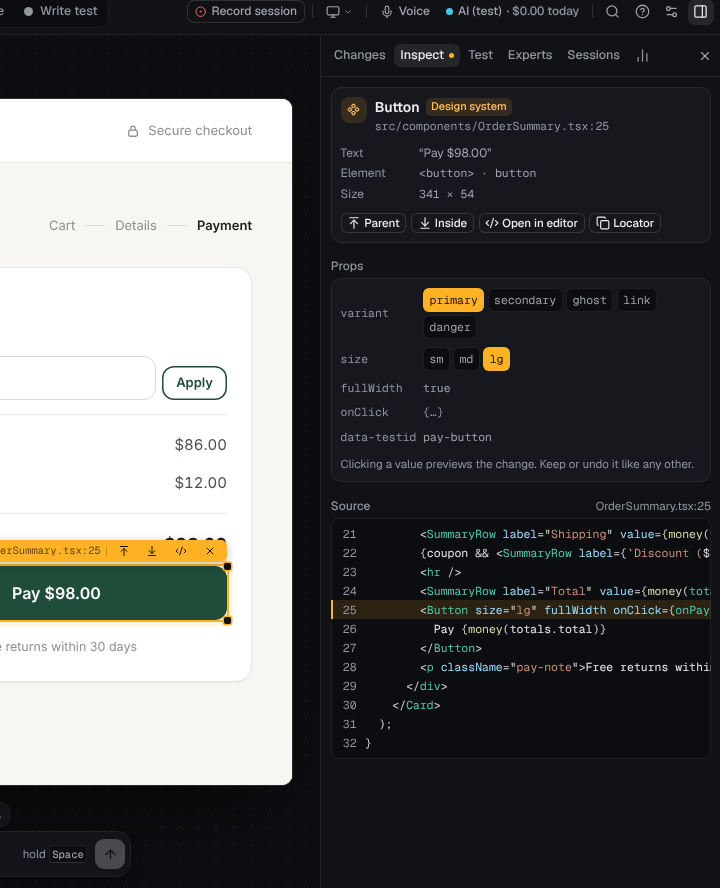

Try also:

- <kbd>↑</kbd> selects what contains it, <kbd>↓</kbd> what is inside it, <kbd>←</kbd> <kbd>→</kbd> the previous or next one.
- <kbd>Alt</kbd>+click selects the inner element instead of the component.
- <kbd>O</kbd> opens the file at that line in your code editor.
- Click it again, or press <kbd>Esc</kbd>, to deselect.

## 5. Change it, then keep or undo

Click the **Apply** button next to the coupon field. Type `make this bigger` in the command bar and press <kbd>Enter</kbd> (or hold <kbd>Space</kbd>, say it, and let go).

**What you see:** the button grows at once. This is a **preview**: the change is already in the file and in the running app. The bar at the top says what changed (`size sm → md`), where (`CouponField.tsx`), and how: a *quick edit*, made on your computer in milliseconds, free, without an AI.

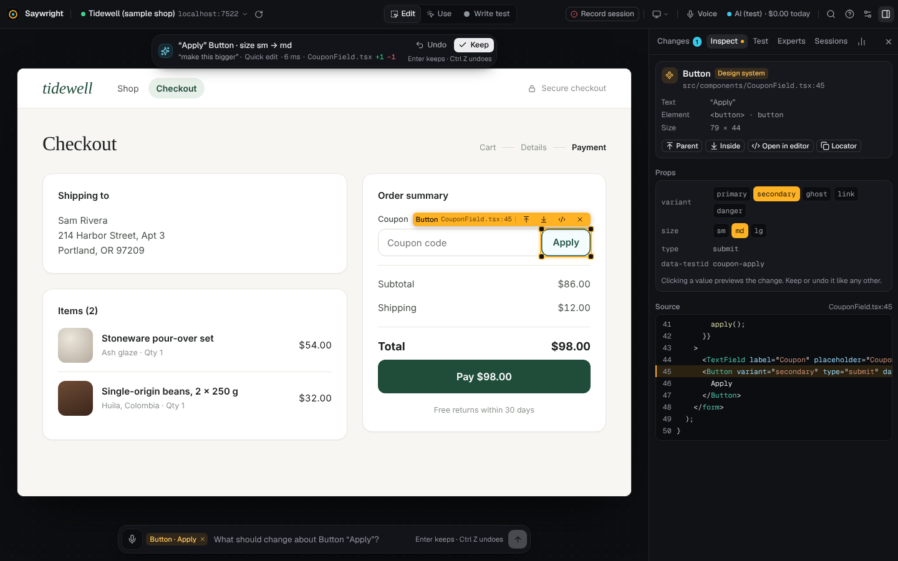

- <kbd>Enter</kbd> (or **Keep**, or saying “keep it”) keeps it.
- <kbd>Ctrl</kbd>+<kbd>Z</kbd> (<kbd>⌘</kbd>+<kbd>Z</kbd> on a Mac, or **Undo**) puts the file and the app back.

Keep it. The **Changes** tab lists every change with what you said; click one to see its diff.

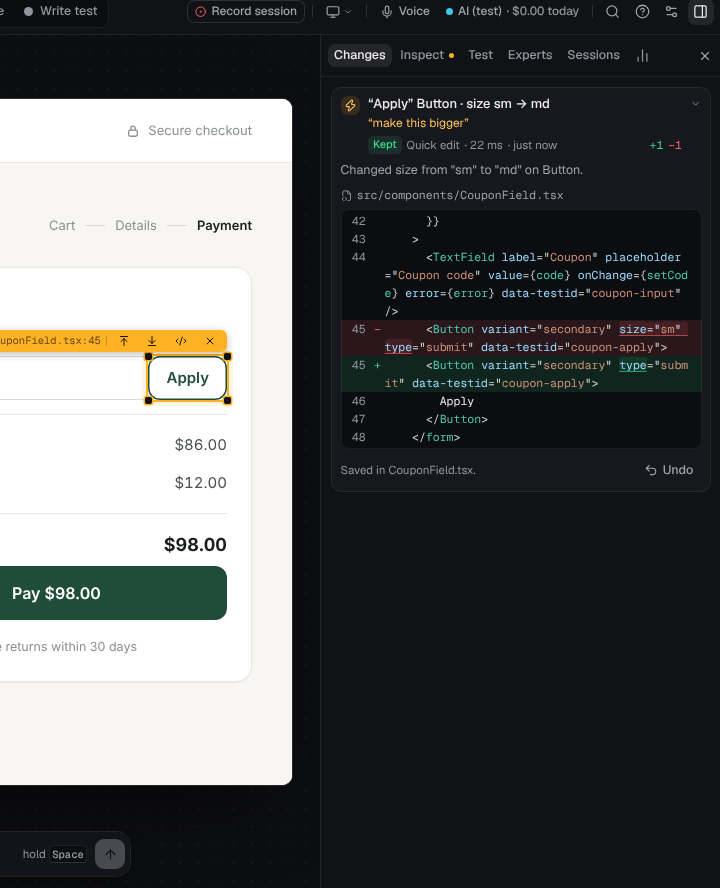

More quick edits to try on any button or text: “make it ghost”, “make it smaller”, “rename this to Use code”, “remove this”. Previews stack, so you can try a few and keep them together or undo them one at a time. Nothing is committed to git unless you turn that on in **Settings → General**.

## 6. Point at two things

Click **Apply**, then <kbd>Shift</kbd>+click **Pay**. The first is “this” (**1**), the second “that” (**2**).

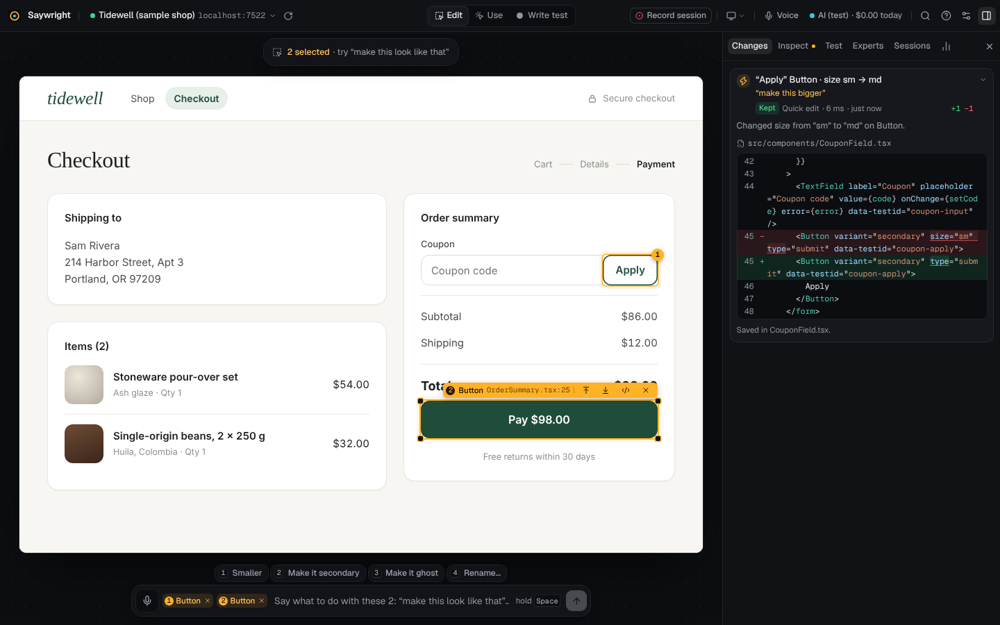

Say or type `make this look like that`: Apply takes Pay's look. Undo it with <kbd>Ctrl</kbd>+<kbd>Z</kbd>, then press <kbd>Esc</kbd> to clear the selection.

You can also point while you talk: hold <kbd>Space</kbd>, point at the first while you say “this” and at the second while you say “that”.

## 7. Ask a question

_Needs an AI._ Type `why is the total wrong when I use SAVE20?` and press <kbd>Enter</kbd>.

**What you see:** the answer appears at the top, with `file:line` references. Click one to open the code there.

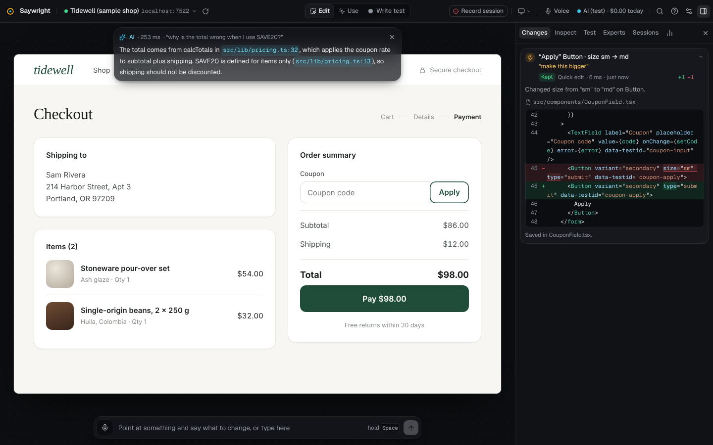

Anything that isn't a quick edit or a question (“add a free-shipping banner above the summary”) goes to the AI too, and comes back as a preview to keep or undo.

## 8. Turn the bug into a test

1. Press <kbd>R</kbd> for **Write test**. From now on, what you do in the app becomes the steps of a test, in the **Test** tab.
2. Type `SAVE20` in the coupon field and click **Apply**. The total shows **$78.40**.
3. Point at the total and say `this should show $80.80`, or click the command bar at the bottom and type it there: the check is about what you pointed at last. (After **Apply** the keyboard is in the app, so <kbd>/</kbd> doesn't reach the studio until you click it.) That is a check.
4. Click **Generate test**: a Playwright test is written to `tests/saywright/` in the shop's folder.
5. Click **Run test** (or **Run it**). It fails, *expected $80.80, got $78.40*, which proves it reproduces the bug.

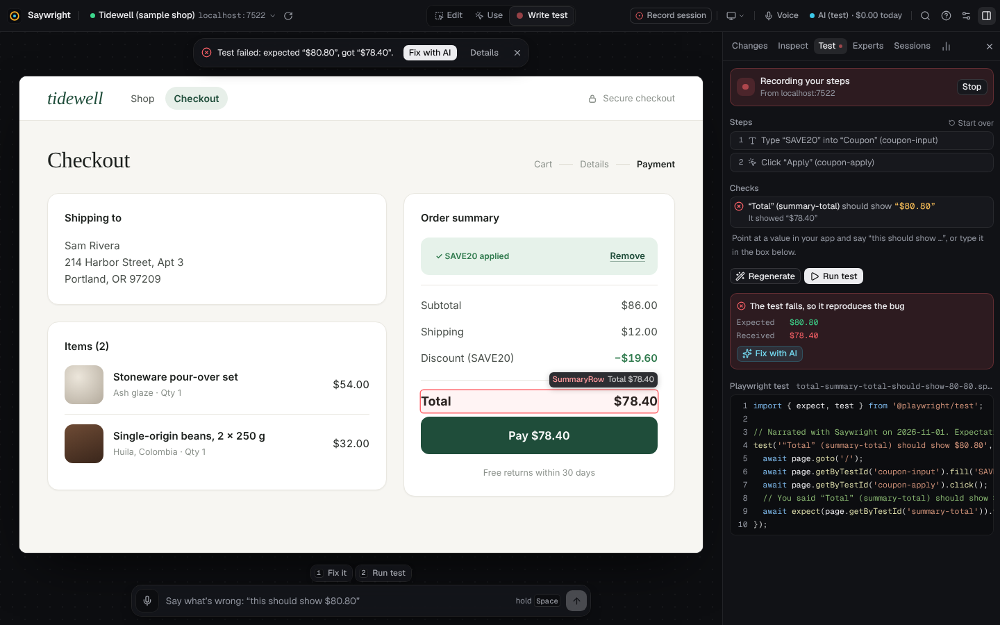

6. _Needs an AI._ Click **Fix with …**. The AI changes `src/lib/pricing.ts`, and the studio runs the test again with the fix.

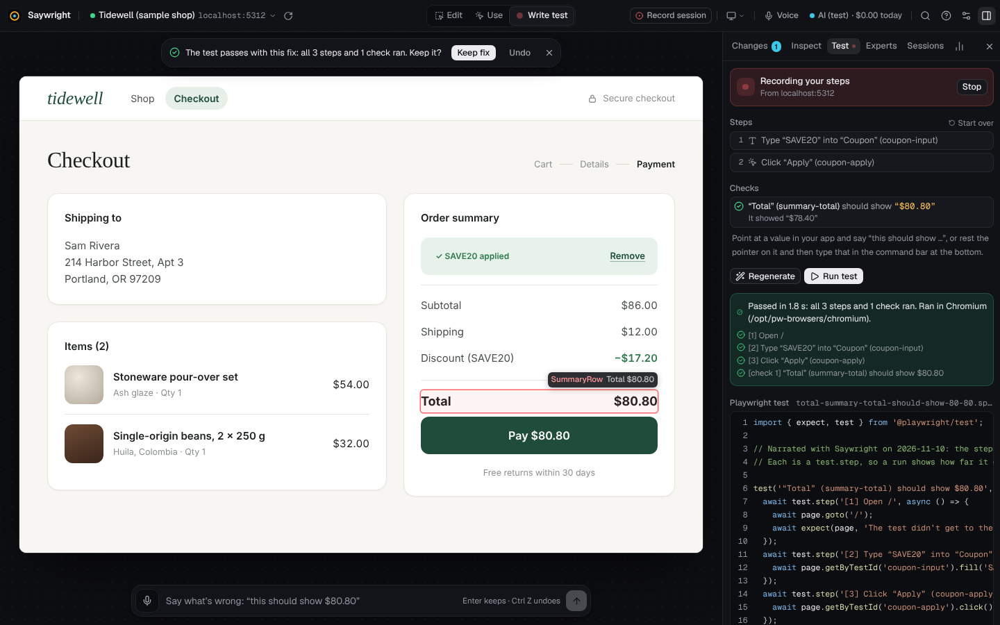

For this walk-through, click **Undo**, so the bug is still there for the next steps (on your own app, you would click **Keep fix**). Then press <kbd>E</kbd> to go back to Edit mode.

> Running the test needs Playwright in the app. The sample shop has it; if the browser isn't installed, the Test tab offers **Install test browser**.

## 9. Record a session

Reload the shop (the arrow next to the app's name) so the coupon is off again, then click **Record session** in the top bar.

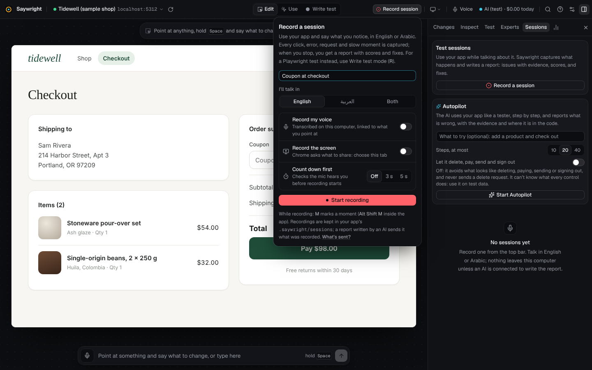

Choose the language you will talk in, and whether to record your voice and the screen, then click **Start recording**. Now use the shop as a customer would: type `SAVE20`, click **Apply**, look at the total. If your voice is on, say what you notice: point at the total and say “this should show eighty dollars eighty”.

**What you see:** a bar under the top bar with the time, how many events were captured, what you said, and the issues seen so far. **Mark** (or <kbd>M</kbd>) marks a moment for the report.

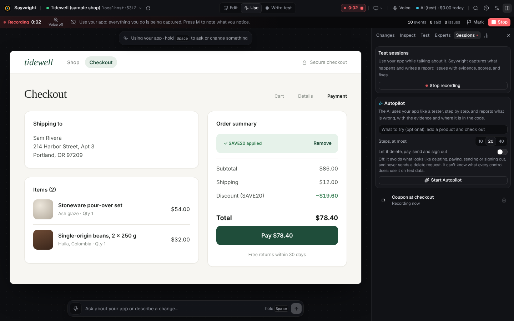

Click **Stop**.

## 10. Read the report

When **Report ready** appears, click it.

**What you see:** a verdict and what it is based on, scores, and the findings, each with its evidence (what you said, what the screen showed, errors, failed requests, screenshots) and where to look in your code. On the right: the timeline of everything that happened, the transcript, and the video when the screen was recorded.

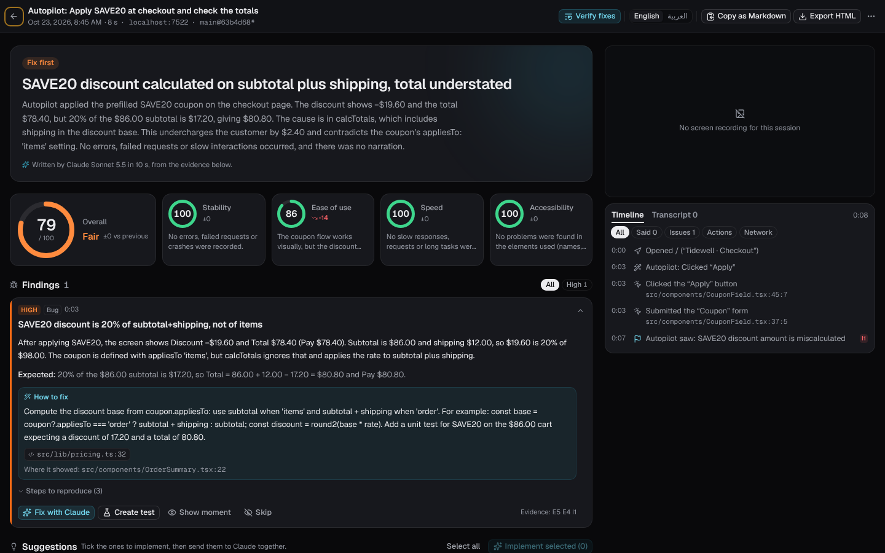

This report was written by the AI, for an Autopilot run ([step 12](#12-let-autopilot-test-the-shop)). With an AI connected, the report reads what the screen showed after each action, so it finds that SAVE20 also discounts shipping even if you said nothing. Without one, the report is written on your computer from what was recorded: errors, failed requests, slow moments, and what you said, such as “this should show $80.80” while pointing at the total. **Copy as Markdown** and **Export HTML** share it; **English / العربية** switches its language.

## 11. Fix it, then verify the fix

_Needs an AI._ On the finding, click **Fix with …**. The report closes and the fix arrives as a preview: press <kbd>Enter</kbd> to keep it.

Open the report again (**Sessions** tab, then the session) and click **Verify fixes**. The session plays again on its own in your app, and the report says, finding by finding, whether it is fixed.

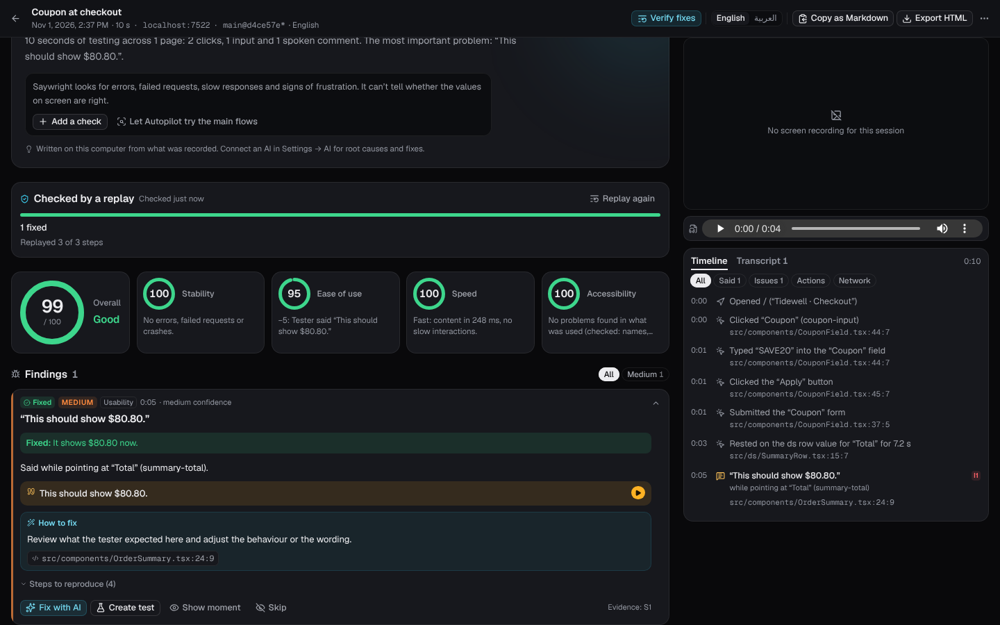

## 12. Let Autopilot test the shop

_Needs an AI._ Open the **Sessions** tab. Under **Autopilot**, type a goal such as `Apply SAVE20 at checkout and check the totals`, and click **Start Autopilot**.

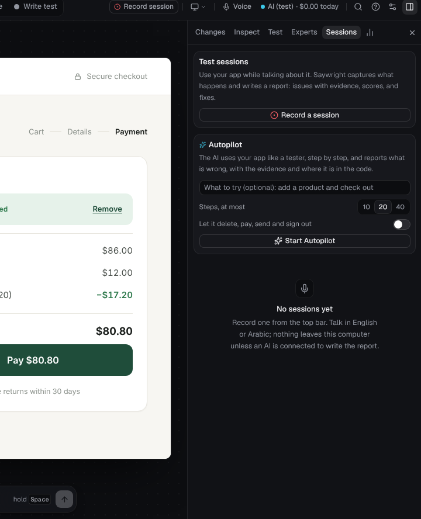

**What you see:** the AI uses the shop like a tester, step by step, with its pointer on what it is using and each step described at the top. **Stop** ends it at any time. It leaves deleting, paying, sending and signing out alone unless you switch that on. It ends in a report like the one in step 10.

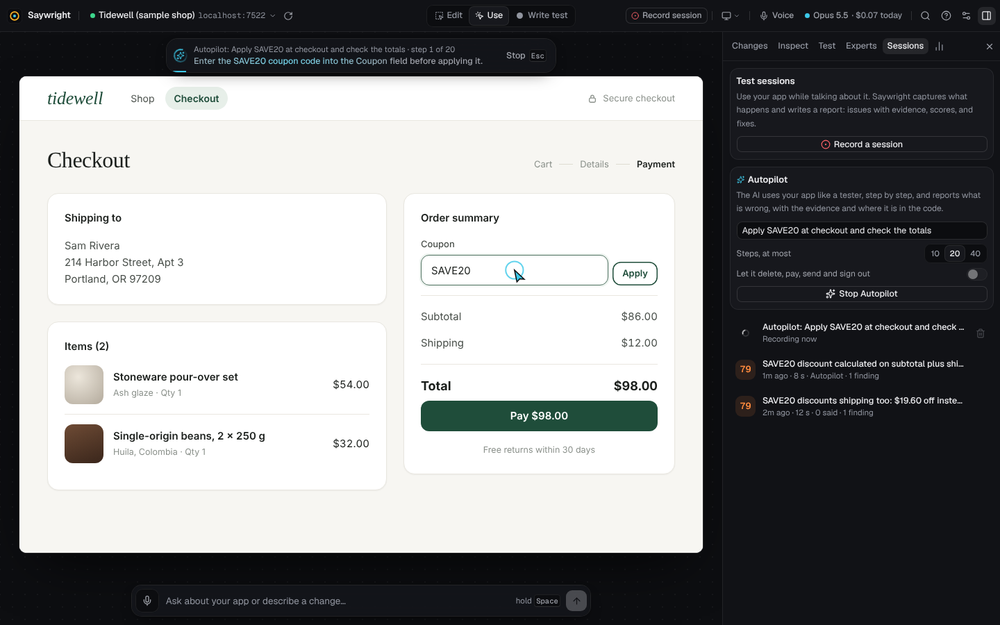

## 13. Review the page with the Experts

Open the **Experts** tab and click **Review this page**.

**What you see:** four experts, SEO, Content, UI/UX and Accessibility (WCAG 2.2, checked with axe-core), each with what it found. Click a finding to see what it means, how to fix it, and where it is on the page. **Fix all with AI** fixes an expert's findings in place, and **Ask AI** gives that expert's opinion of the page (_needs an AI_).

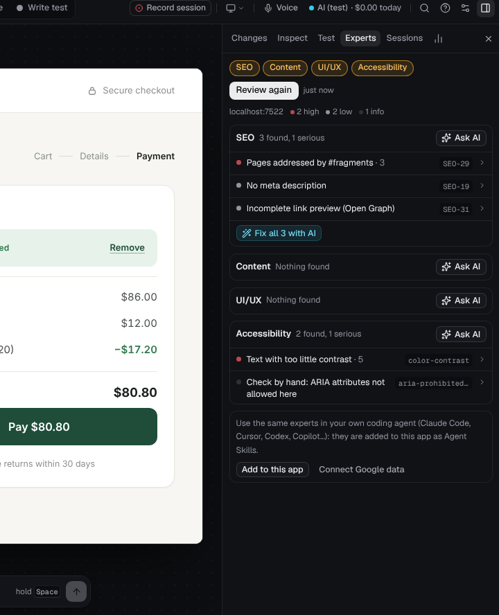

## 14. Settings worth knowing

Open **Settings**: the icon next to **Help** (<kbd>?</kbd>) at the right of the top bar.

**AI.** Connect an AI: your plan (through Claude Code, Codex or Gemini CLI, with no API key and no extra bill), an API key, or a model on your computer with Ollama or LM Studio. Each kind of work can use a different one. Details: [AI in Saywright](ai.md).

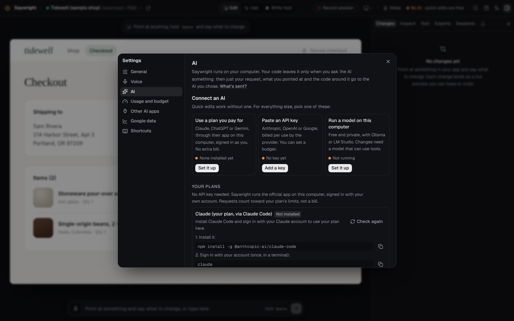

**Usage and budget.** Every AI call: tokens, cost and what caching saved, by day, feature, model and app, with a daily and a monthly limit (by default $5 and $50).

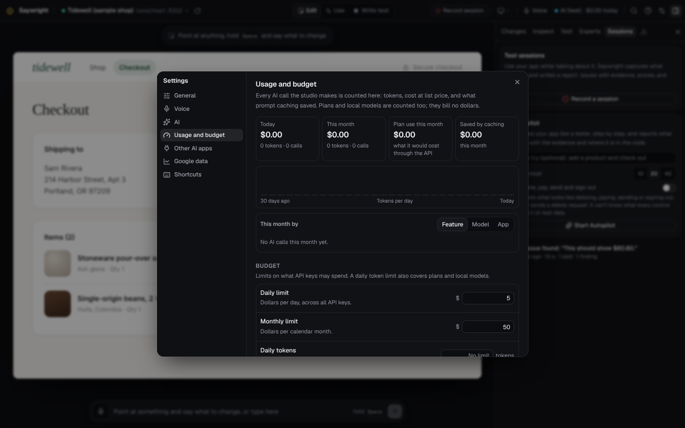

**Voice.** How speech is recognised (in the browser, on your computer, or both), your language and accent, the speech models, and a microphone test. Details: [Voice](guide.md#voice).

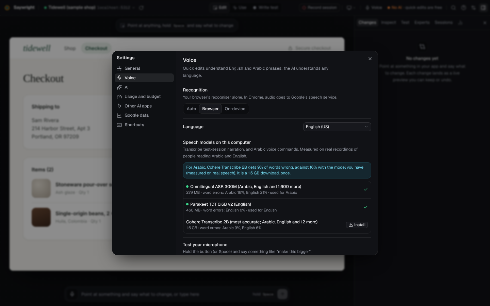

**Other AI apps.** Connect Claude Code, Cursor, Codex, VS Code or Claude Desktop to the studio over MCP: they see what you point at, and their changes come back as previews. Details: [MCP](mcp.md).

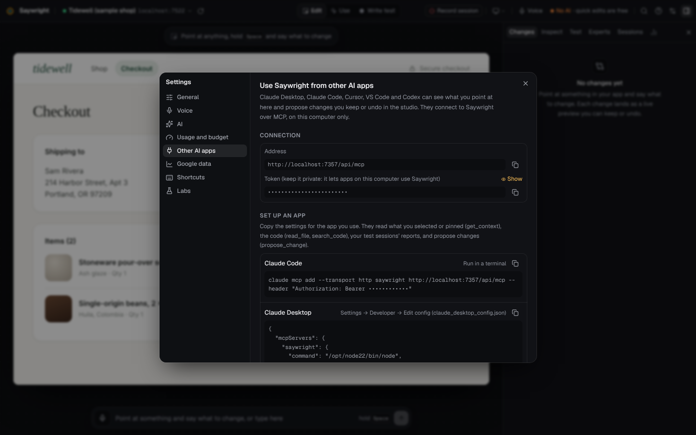

Two more ways to find anything: <kbd>Ctrl</kbd>+<kbd>K</kbd> (<kbd>⌘</kbd>+<kbd>K</kbd>) opens the command palette, every action by name, and <kbd>?</kbd> shows the phrases and shortcuts.

<p>
  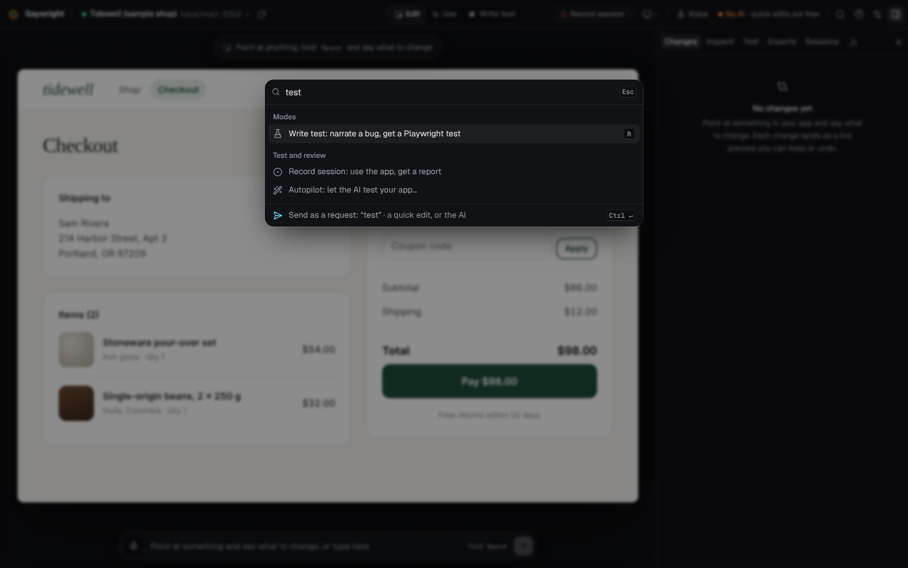
  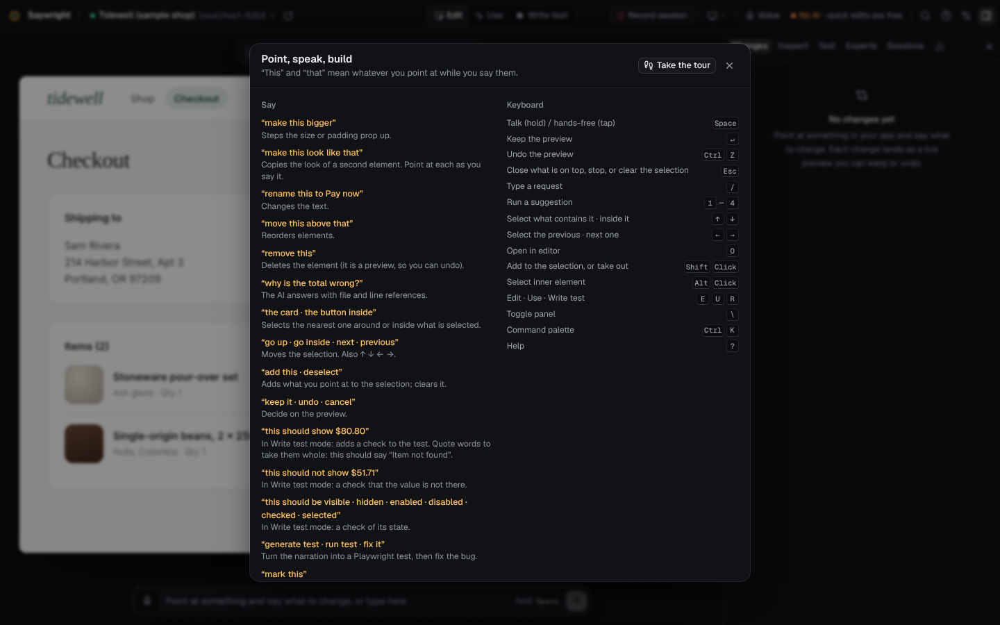
</p>

## 15. Link your own app

Open the app menu (top left) and choose **Link an app**, or **All apps**, then **Link an app**:

- **Folder on this computer**: the studio finds the app's dev command, starts it, and follows it to its port.
- **Address**: anything already running (`http://localhost:3000`) or deployed, shown through the studio's local proxy.
- **GitHub**: the repository is cloned into `~/saywright-apps`, installed and started.

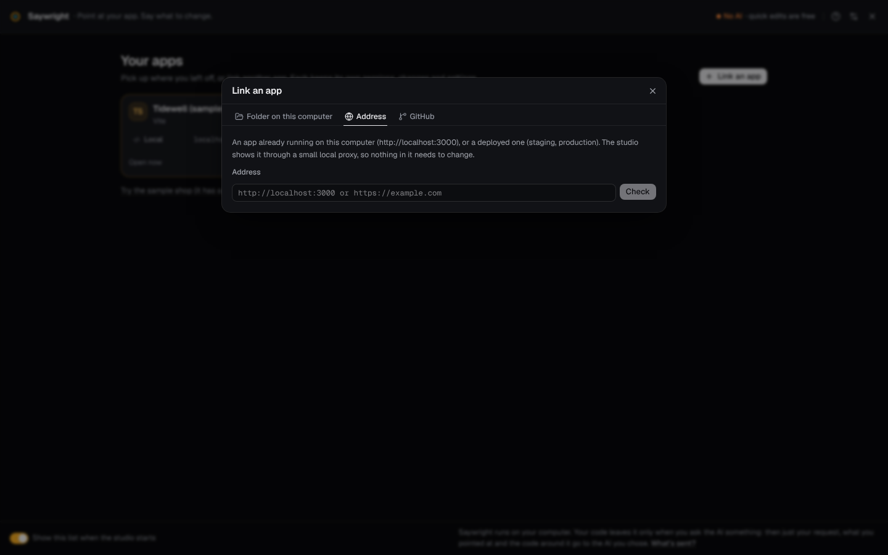

For the exact file and line of every element in a React app on Vite, run `npx @saywright/studio connect ./my-app` once: it adds the `@saywright/vite` plugin. Everything about linking: [Linking your apps](apps.md).

To put the sample shop back as it was: delete `~/.saywright/sample-shop` and remove the shop from **All apps** (in a checkout of this repository: `npm run reset:sample`).

## Where next

- [Using the studio](guide.md): everything you can say, the keyboard and voice.
- [Sessions and reports](session-report.md), [Autopilot](autopilot.md), [Experts](experts.md).
- [Troubleshooting](troubleshooting.md), if something doesn't work as described here.
