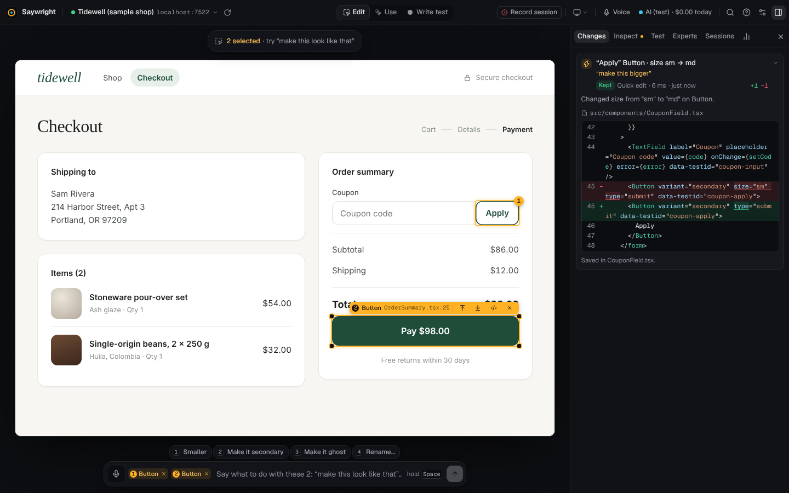
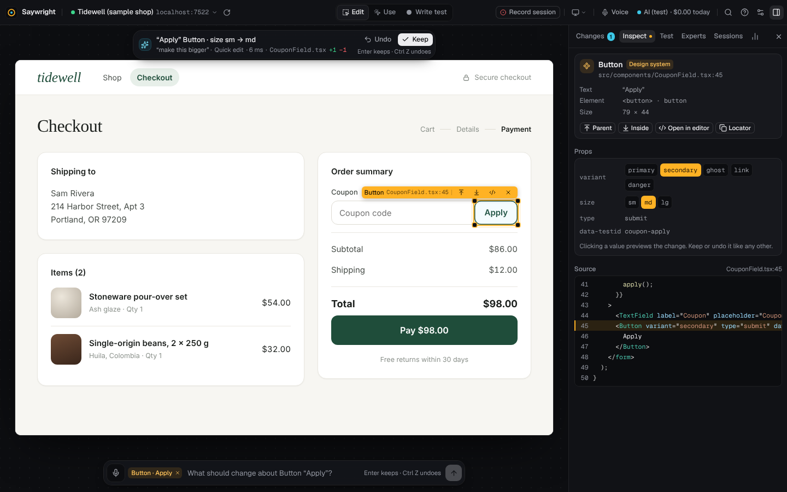
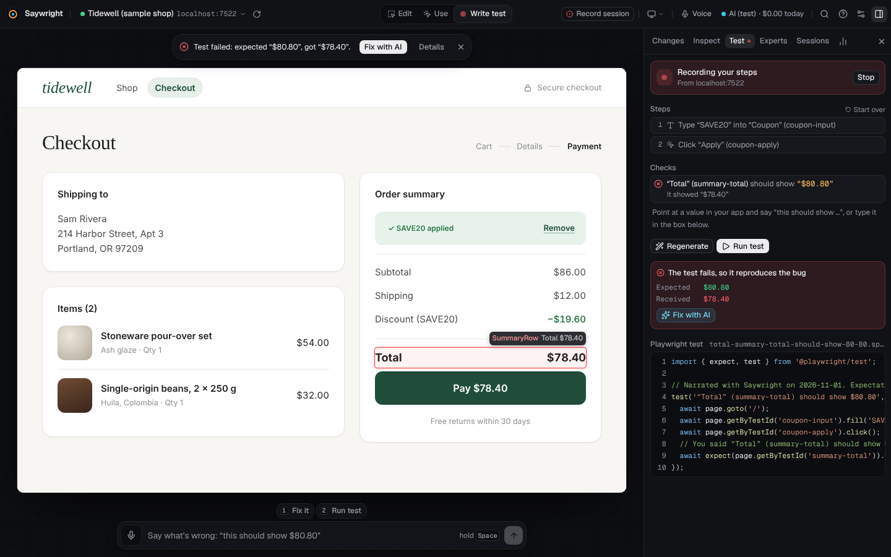
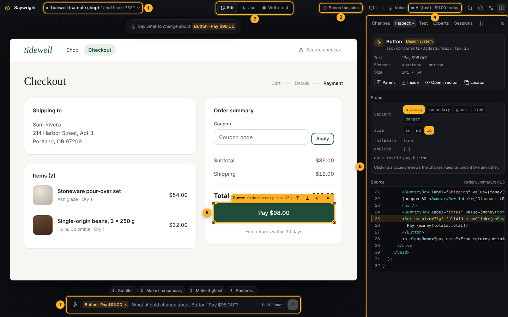
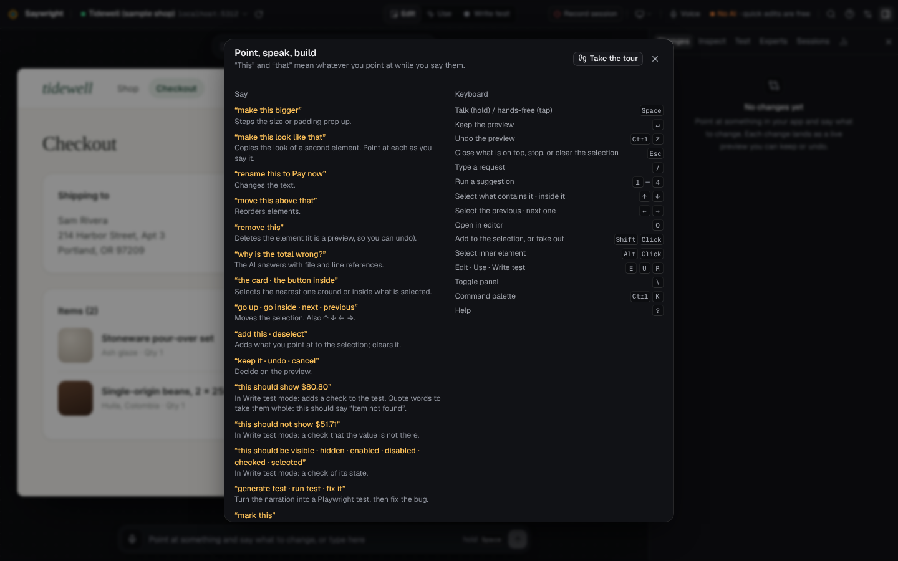
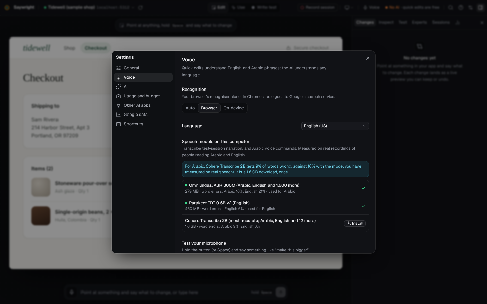

# Using the studio

How to point, say what to change, and keep or undo the result; the three modes; writing a Playwright test by narrating a bug; the keyboard and voice. New to Saywright? [Getting started](getting-started.md) walks through all of it on the sample shop, with pictures. For linking apps see [Linking your apps](apps.md); for sessions, Autopilot and the Experts see the [documentation index](README.md).

- [The one idea](#the-one-idea)
- [Previews: keep or undo](#previews-keep-or-undo)
- [Modes: Edit, Use, Write test](#modes-edit-use-write-test)
- [Saying or typing what to change](#saying-or-typing-what-to-change)
- [Write test: narrate a bug, get a Playwright test](#write-test-narrate-a-bug-get-a-playwright-test)
- [The screen](#the-screen)
- [Keyboard](#keyboard)
- [Voice](#voice)
- [A five-minute tour of the sample shop](#a-five-minute-tour-of-the-sample-shop)

## The one idea

**“This” and “that” mean whatever you point at while you say them.** Select the **Apply** button, hold <kbd>Space</kbd>, say “make this bigger”, and let go. To refer to two things, point at the first while you say “this” and at the second while you say “that”, or select both (<kbd>Shift</kbd>+click): the first is “this”, the second “that”.



## Previews: keep or undo

Every change is a **preview**. It is already in your code and in your running app, and the **Changes** tab shows its diff. Then:



- **Keep** it with <kbd>Enter</kbd> (or say “keep it”);
- **Undo** it with <kbd>Ctrl</kbd>+<kbd>Z</kbd>, <kbd>⌘</kbd>+<kbd>Z</kbd> on a Mac (or say “undo”).

Previews stack: “bigger”, then “and red”, then “keep it” keeps both; undo removes the newest first. If a file was edited elsewhere after the preview, undo refuses rather than lose that work. Previews survive a restart of the studio: they come back still waiting for keep or undo.

Nothing is committed unless you turn on **Settings → General → Commit when you keep a change** (in a git repository): each kept change then becomes a commit with what you said.

## Modes: Edit, Use, Write test

The switch in the middle of the top bar:

| Mode | Key | What a click does | Use it to |
| --- | --- | --- | --- |
| **Edit** | <kbd>E</kbd> | Hover highlights, click selects (click again to deselect), <kbd>Shift</kbd>+click adds to the selection, right-click opens actions | Point at things and change them |
| **Use** | <kbd>U</kbd> | Clicks go to your app as usual | Get to the right screen or state |
| **Write test** | <kbd>R</kbd> | Clicks go to your app, and each action becomes a test step | Narrate a bug and turn it into a Playwright test |

Don't confuse **Write test** with **Record session** (the button on the right of the top bar). Record session records you using the app and ends in a report of what went wrong: see [Sessions and reports](session-report.md). Write test ends in a Playwright test.

## Saying or typing what to change

Hold <kbd>Space</kbd> and talk, then let go; or tap <kbd>Space</kbd> to talk hands-free (it sends when you pause). Press <kbd>/</kbd> to type instead.

| Say or type | What happens |
| --- | --- |
| “make this bigger / smaller”, “more spacing”, “tighter” | Steps a design-system component's size or padding (a quick edit) |
| “make this red / ghost / primary / outline” | Sets a design-system variant (a quick edit; words map to values through [synonyms](apps.md#describe-your-design-system-saywrightconfigjson)) |
| “rename this to Place order” | Changes the text (a quick edit) |
| “make this look like that” | Copies the look of the second element |
| “move this above that”, “remove this” | Reorders or removes elements (quick edits) |
| “why is the total wrong?” | The AI answers, with `file:line` references you can click ([picture](media/guide/answer.png)) |
| anything else | The AI makes the change and shows it as a preview |
| “keep it”, “undo”, “cancel”, “clear” | Decide on the preview; stop; clear the selection |
| “the card”, “select the button inside”, “go up”, “go inside”, “next”, “previous” | Move the selection |
| “add this”, “this too”, “deselect” | Add what you point at to the selection; clear it |
| “click this”, “type SAVE20 and press enter”, “scroll down” | Drive the app |
| “this should show $80.80” (in Write test) | Adds a check to the test |
| “generate test”, “run test”, “fix it” | The bug-to-test flow below |
| “mark this” (while recording a session) | Marks the moment for the report |

**Quick edits** (size, variant, text, move, remove) are made on your computer in milliseconds, for free, with no AI. They work on React components. When a quick edit can't do something safely (the largest size already, code that changed since you selected the element, a file that doesn't parse right now), the studio says why and offers **Ask the AI anyway** or the file to open. A label built from code (“Pay {total}”) goes to the AI you connected; without one, the studio says why and where it is written. A request of more than one part (“make this bigger and red”) goes to the AI whole. **Remove** also takes out the imports and props only the removed element used, and names anything else it leaves unused. A quick edit on code that draws several elements says so in its title: “(all 50 on this page)” for a list's rows, “Card is used in 6 places” for a shared component. Everything else goes to the AI you chose in **Settings → AI** ([AI in Saywright](ai.md)).

Requests run one at a time: one you make while another is running waits its turn, and <kbd>Esc</kbd> stops the running one.

## Write test: narrate a bug, get a Playwright test



1. Switch to **Write test** (<kbd>R</kbd>) and use your app: each click, typing, choice in a list and <kbd>Enter</kbd> is recorded as a step in the **Test** tab. A link that opens another page adds a step that waits for it.
2. Point at what is wrong and say what it should show: “this should show $80.80”. That becomes a check, in the test where you said it: after the steps before it, before the steps after it. Of a checkbox, a radio button or a switch (or its label), say “this should be checked” or “this shouldn't be checked”; of an option in a list, “this should be selected”.
3. Say “generate test” (or **Generate test**): a Playwright spec is written to `tests/saywright/` in your app's folder. Each step and check is a numbered `test.step`.
4. Say “run test” (or **Run test**). It runs with your app's own Playwright (`@playwright/test` installed in the app) and a configuration of the studio's own: Chromium, no retries, a fresh browser, and the app the studio has open as its `baseURL`. Your app's Playwright configuration doesn't change the verdict.
5. Say “fix it”: the AI fixes the code and the studio runs the same test again with the fix. When it passes, verified, keep the fix.

**What a run says.** A run is believed only when it shows something:

| The Test tab says | It means |
| --- | --- |
| **The test fails at its check, so it reproduces the bug** | Every step ran and the check failed: the bug shows. **Fix with …** is offered. |
| **It doesn’t show the bug yet** | A step before the checks failed (a field that isn’t there, a page that didn’t come): the test never got to its check. Fix the step, then run it again. |
| **Passed: all 4 steps and 1 check ran** | Verified: it passed on the first try, every step and check reported that it ran, and (after a fix) the test is the one that failed, unchanged. |
| **Couldn’t verify** | It passed, but that proves nothing: a step or check didn’t run, it passed only when tried again, it has no check, or the test changed since it failed (by hand, or by any AI request). The next run judges the test as it is then. |

A fix may not change the test it is checked against: if the AI's change edits that test, that part is left out (and a change that only edits the test is refused), so a weakened check can't pass for a fix.

**Passwords and other secrets.** What you type into a password field, or a field for a card number, a one-time code, an API key or a token, is never recorded: the step names it (`PASSWORD`, `CARD_NUMBER`), and the test types it from the environment variable `SAYWRIGHT_SECRET_PASSWORD`. The **Secrets** section of the Test tab saves its value on this computer, with the studio's data, outside your code; the studio sets it when it runs the test, and Replay & verify types it in the replay. Elsewhere (your CI), set the variable yourself. To mark a field of your own as secret, give it (or a parent) `data-saywright-secret`; the marks session-replay tools use (`data-private`, `data-sentry-mask`, `.rr-mask`, `.fs-mask`…) work too.

**Lists.** A choice in a drop-down becomes `selectOption({ label: 'Express' })` (by its value when what it says has numbers in it, like a price); in a list that takes several choices, every one chosen.

**Checks that hold once the fix is in.** A check reads what an element shows, so it is never found by the words it checks, which the fix changes: the value in a table row by the row's heading (`getByRole('row').filter({ hasText: 'You pay' }).locator('td')`), a name with a price or a count by a pattern with the numbers left open (`getByRole('button', { name: /^Like this portfolio \(\d[\d.,]*\)$/ })`), else by its place among the same. Steps find a name with numbers the same way, so a fix that changes a total doesn't lose the Pay button. A box checks `toBeChecked()`, and a list the options chosen in it.

**The Test tab** shows each check's own result in the last run (passed, failed, or not reached), and keeps the test being written when you reload the studio.

**Repeatable runs.** Each run starts from a fresh browser: no cookies, no storage. For data the test needs (an account, an empty cart), add `tests/saywright/setup.ts`: it runs before the test, as Playwright's global setup, to put that data in place.

To run a generated test with your own Playwright configuration (in CI, say), give the configuration a `baseURL`; the studio sets `SAYWRIGHT_TARGET_URL` when it runs tests itself:

```ts
// playwright.config.ts
use: { baseURL: process.env.SAYWRIGHT_TARGET_URL ?? 'http://localhost:5173' },
```

If Playwright's browser isn't installed, the Test tab offers **Install test browser**.

## The screen



1 the app menu, 2 the modes, 3 **Record session**, 4 the AI chip, 5 the side panel, 6 your app with what is selected, 7 the command bar.

**The top bar**, from left to right: the app menu (switch apps, **All apps**), reload the app, the mode switch, **Record session**, the viewport size (fit to window, desktop 1280, tablet 820, phone 390), the microphone, the **AI chip**, the command palette, help, settings and the side panel.

**The AI chip** always shows who answers and what today has cost: the model and “$0.42 today” with an API key, “no extra bill” on your plan, “free” for a model on your computer, or “No AI · quick edits are free”. It turns amber near your budget and red at it. Click it for **Settings → AI**, or for the usage once there is some.

**The side panel** (<kbd>\\</kbd> shows or hides it):

| Tab | What it has |
| --- | --- |
| **Changes** | Every preview and decision, with what you said and a word-level diff. Keep or undo any of them. |
| **Inspect** | The selected element: its component, file and line, props and source. Click a design-system value to preview it. |
| **Test** | Write test: the recorded steps and checks, the generated Playwright test and its result. |
| **Experts** | Page reviews for SEO, content, UI/UX and accessibility ([Experts](experts.md)). |
| **Sessions** | **Record a session**, [Autopilot](autopilot.md), and your sessions with their reports ([Sessions and reports](session-report.md)). |
| **Stats** (chart icon) | How you worked: voice or typed, pointing or not, time to preview, how often you kept a change. **Export session (JSONL)** downloads it. |

**The command palette** (<kbd>Ctrl</kbd>+<kbd>K</kbd>, <kbd>⌘</kbd>+<kbd>K</kbd> on a Mac, [picture](media/guide/palette.png)) lists every action by name. <kbd>Enter</kbd> runs the highlighted one; to send what you typed as a request to the AI instead, choose its own row or press <kbd>Ctrl</kbd>+<kbd>Enter</kbd> (<kbd>⌘</kbd>+<kbd>Enter</kbd> on a Mac).

**Settings**: General (appearance, commit when you keep a change, sounds, the setup tour), Voice, AI, Usage and budget, Other AI apps ([MCP](mcp.md)), Google data ([Experts](experts.md#google-data)), and Shortcuts.

## Keyboard

<kbd>?</kbd> shows the phrases and the keys in the studio:



| Key | What it does |
| --- | --- |
| <kbd>Space</kbd> (hold) | Talk; let go to send. Tap it for hands-free (sends when you pause). |
| <kbd>Enter</kbd> | Keep the preview |
| <kbd>Ctrl</kbd>+<kbd>Z</kbd> (<kbd>⌘</kbd>+<kbd>Z</kbd>) | Undo the preview |
| <kbd>Esc</kbd> | Close what is on top; with nothing open, stop, then clear the selection |
| <kbd>/</kbd> | Type a request |
| <kbd>1</kbd> to <kbd>4</kbd> | Run a suggestion shown above the command bar |
| <kbd>↑</kbd> <kbd>↓</kbd> | Select what contains the selection, or what is inside it |
| <kbd>←</kbd> <kbd>→</kbd> | Select the previous or next one |
| <kbd>O</kbd> | Open the selected element's file at its line in your code editor ([which one](configuration.md#other-variables)) |
| <kbd>Shift</kbd>+click | Add to the selection, or take out |
| <kbd>Alt</kbd>+click (<kbd>⌥</kbd>+click) | Select the inner element instead of the component |
| <kbd>E</kbd> <kbd>U</kbd> <kbd>R</kbd> | Edit, Use, Write test |
| <kbd>M</kbd> | Mark this moment, while recording a session |
| <kbd>\\</kbd> | Show or hide the side panel |
| <kbd>Ctrl</kbd>+<kbd>K</kbd> (<kbd>⌘</kbd>+<kbd>K</kbd>) | Command palette |
| <kbd>?</kbd> | Phrases and shortcuts |

In your app's own tab, the **Record session** button has its own keys: <kbd>Alt</kbd>+<kbd>Shift</kbd>+<kbd>R</kbd> starts and stops, <kbd>Alt</kbd>+<kbd>Shift</kbd>+<kbd>M</kbd> marks a moment, <kbd>Alt</kbd>+<kbd>Shift</kbd>+<kbd>D</kbd> hides the button, and while recording shrinks the recorder to a small dot (<kbd>Option</kbd> for <kbd>Alt</kbd> on a Mac). Its ⇆ button moves it to the other side of the page.

## Voice

What you say is heard two ways at once, then checked against the recording:

- **your browser's recogniser** (Chrome, Edge or Safari; Chrome's runs on Google's servers) shows the words while you talk;
- **a speech model on your computer** listens to the same recording: [Moonshine](https://github.com/moonshine-ai/moonshine) for English (28 MB, from `saywright setup` or **Settings → Voice**). It keeps a first word the browser missed, and catches misheard studio words (“make this beggar” becomes “make this bigger”).

The studio keeps the moment before you press <kbd>Space</kbd> and listens a little after you let go, so your first and last words aren't cut off.

**Settings → Voice** has:



- **Recognition**: *Auto* (both, recommended), *Browser* (the browser alone), or *On-device* (only the model on your computer: audio never leaves it).
- **Language**: pick the variant closest to how you speak (US, UK, India…, or an Arabic variant).
- **Speech models on this computer**: install or choose the models that transcribe session narration and Arabic commands ([measured accuracy](speech-accuracy.md)).
- **Test your microphone** and **Accuracy on your voice**: see what each recogniser heard, and how many words each gets right for your voice.
- **Check before sending**: what you said appears in the command bar first, to fix before you press <kbd>Enter</kbd>.
- **Microphone → Turn off now**: after you talk, the microphone stays open for two minutes so your next sentence isn't cut off; this closes it at once.

Tips: point first, then talk. Short, plain phrases work best. A headset helps in a noisy room. Press <kbd>/</kbd> to type a word that keeps being misheard, such as a product name.

### In Arabic

Choose an Arabic variant in **Settings → Voice → Language**. What you say is then also transcribed by the Arabic speech model on your computer (installed by `saywright setup`), and the studio uses the reading it understands. Commands work in Egyptian, Gulf, Levantine and Modern Standard phrasing, with English words mixed in:

| Say | What it does |
| --- | --- |
| كبّر هذا، خليه أكبر، صغّر هذا | Bigger, smaller |
| اجعله أحمر، خلي الزرار ده أزرق | A colour or variant |
| احذف هذا، انقل هذا فوق ذلك، حط ده تحت ده | Remove, reorder |
| اجعل هذا مثل ذلك | Make this look like that |
| زود المسافة بين الكروت | More spacing |
| احتفظ به، تمام كده / تراجع / إلغاء | Keep, undo, cancel |
| المفروض يكون ثمانين دولار وثمانين سنت | In Write test: a check that it shows $80.80 |
| اكتب اختبار لهذا، شغّل الاختبار، صلحه | The bug-to-test flow |
| انزل لتحت، اطلع لفوق، اختار الأب | Scroll, select the parent |

Anything else in Arabic goes to your AI as you said it.

## A five-minute tour of the sample shop

Open the sample shop from **Your apps** (in a checkout: `npm run dev -- --sample`). It has a real bug: the coupon `SAVE20` should take 20% off the items only, but it also discounts shipping.

1. **Select and change.** In Edit mode, click the **Apply** button. Say or type “make this bigger”. Keep it with <kbd>Enter</kbd>.
2. **Point twice.** Select **Apply**, <kbd>Shift</kbd>+click **Pay**, and say “make this look like that”. Undo it with <kbd>Ctrl</kbd>+<kbd>Z</kbd>.
3. **Ask.** Say “why is the total wrong?” (needs an AI).
4. **Narrate the bug.** Press <kbd>R</kbd>. Type `SAVE20` in the coupon field and click **Apply**. Point at the total and say “this should show $80.80”. Say “generate test”, then “run test”: it fails, which proves it reproduces the bug. Say “fix it” (needs an AI): it fixes `src/lib/pricing.ts` and the test runs again. When it passes, keep the fix.
5. **Record a session.** Click **Record session**, use the checkout while saying what you notice, and click **Stop** for a report.
6. **Review it.** Open the **Experts** tab and click **Review this page**.

The same tour with a picture of every step, and what you should see at each: [Getting started](getting-started.md).

To put the sample shop back as it was: `npm run reset:sample` in a checkout. Installed from npm, the sample is a copy in `~/.saywright/sample-shop`: delete that folder and remove the app from the list to start again.
