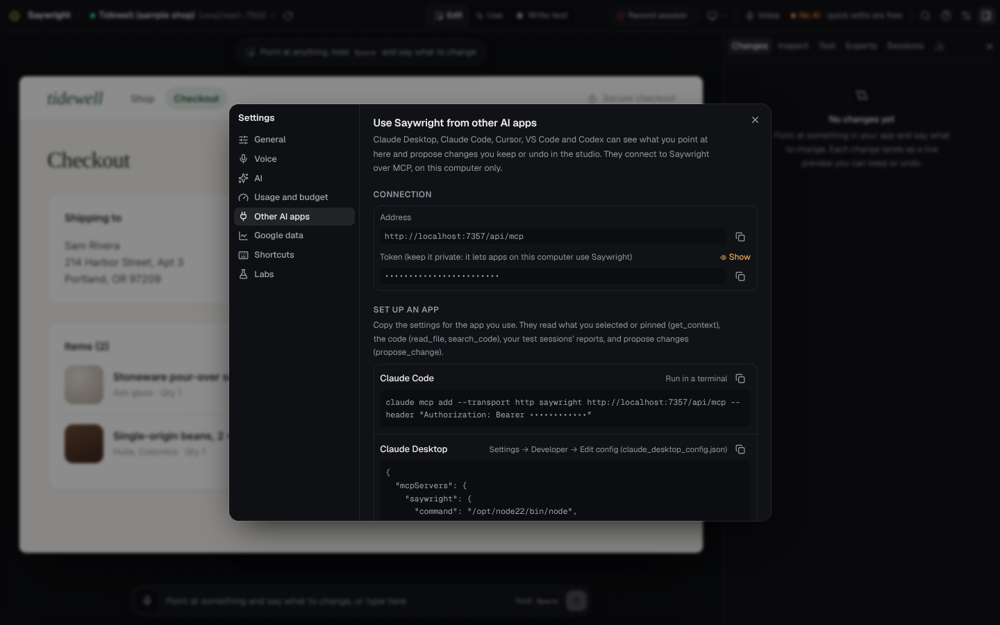

# Use Saywright from your AI apps (MCP)

Saywright is an [MCP](https://modelcontextprotocol.io) server on your computer. Connect Claude Code, Cursor, Codex, VS Code or Claude Desktop to it, and they can see what you point at in the studio, read your app's code, read your session reports, and propose changes. A proposed change shows up live in your app as a preview, and you keep or undo it in the studio.

This is the other way round from **Settings → AI**, where Saywright uses an AI. Here an AI app you already use works with Saywright.

## Connect an app

1. Start the studio (`npx saywright`) and open your app in it.
2. Open **Settings → Other AI apps**. It shows the server's address, a private token, and ready-to-copy settings for each app below, with your address and token filled in.
3. Paste the settings for your app, as below.



The address is `http://localhost:7357/api/mcp` (with the studio's port, if it runs on another one). The token is created when the studio first starts, and kept in `mcp-token` in the studio's data folder (readable by you alone). Treat it like a password: anything on this computer that has it can use Saywright.

### Claude Code

Run in a terminal:

```bash
claude mcp add --transport http saywright http://localhost:7357/api/mcp --header "Authorization: Bearer <token>"
```

### Cursor

In `~/.cursor/mcp.json`:

```json
{
  "mcpServers": {
    "saywright": {
      "url": "http://localhost:7357/api/mcp",
      "headers": { "Authorization": "Bearer <token>" }
    }
  }
}
```

### Codex

In `~/.codex/config.toml`:

```toml
[mcp_servers.saywright]
url = "http://localhost:7357/api/mcp"
http_headers = { Authorization = "Bearer <token>" }
```

### VS Code

In `.vscode/mcp.json` in your project:

```json
{
  "servers": {
    "saywright": {
      "type": "http",
      "url": "http://localhost:7357/api/mcp",
      "headers": { "Authorization": "Bearer <token>" }
    }
  }
}
```

### Claude Desktop

Claude Desktop starts MCP servers as programs, so it runs `saywright mcp`, which passes messages to the running studio. In **Settings → Developer → Edit config** (`claude_desktop_config.json`):

```json
{
  "mcpServers": {
    "saywright": { "command": "npx", "args": ["-y", "saywright", "mcp"] }
  }
}
```

**Settings → Other AI apps** shows the same entry with the full path to this computer's Node.js and Saywright instead of `npx`; either works. From a checkout of this repository, the command is `node <repository>/scripts/mcp-stdio.mjs`.

`saywright mcp` finds the studio through the data folder (`~/.saywright`), so it must use the same `SAYWRIGHT_HOME` as the studio if you changed it. Keep the studio running: without it, every request answers “Saywright isn’t running”.

### Other apps

Any MCP client that speaks Streamable HTTP and can send an `Authorization: Bearer <token>` header can use the address above. Clients that only start programs can use `saywright mcp`.

## What the tools do

| Tool | What it does |
| --- | --- |
| `get_context` | The app open in the studio, the page, and what you selected or pinned there: each element with its file and line and the code around it (marked as a guess when it was found by searching the code for its text), and the last thing you said or typed. Call it when you say “this” or “that”. |
| `propose_change` | Applies edits as a live preview in the studio. You keep or undo it there; the change is named after the app that proposed it. |
| `read_file` | Reads a file of the open app, up to 400 lines at a time. |
| `search_code` | Searches the open app's files for text or a regular expression. When it couldn't search every file in time, it says so and how to narrow the search. |
| `list_files` | Lists the open app's source files under a folder. |
| `list_sessions` | The open app's recorded sessions, newest first, with their scores and findings. |
| `get_session_report` | One session's report: summary, findings with where to fix them and the evidence, and suggestions. Findings you skipped are left out. |

The tools work on the app that is open in the studio. For an app linked by its address alone there is no code on this computer: `get_context` and the session tools still answer, and the code tools say that the app's folder needs linking.

A typical exchange: you select the **Apply** button in the studio and ask your AI app “make this match the Pay button”. It calls `get_context`, reads the file it names, calls `propose_change`, and the change appears in the studio for you to keep or undo.

## How it is protected

- The server answers only requests addressed to `localhost`, `127.0.0.1` or `[::1]`, so a web page can't reach it through DNS rebinding.
- Every request needs the token. A wrong or missing token gets `401`.
- Requests sent by web pages, other than the studio's own, are refused (`403`).
- The file tools read inside the open app's folder only: not `.env` files, `node_modules` or `.git`, and not through links that lead outside the folder.
- A proposed change is a preview: it is written to your files so you see it live, and you keep or undo it in the studio.

When the studio runs Claude Code, Codex or Gemini CLI for your own requests (**Settings → AI → Your plans**), it gives each run its own short-lived token that offers `propose_change` only.

## Protocol details

- Transport: Streamable HTTP at `/api/mcp`, answered as plain JSON (`POST`; `GET` and `DELETE` answer `405`).
- Protocol versions: the stateless `2026-07-28` (with `server/discover`) and the earlier handshake versions `2025-11-25`, `2025-06-18`, `2025-03-26` and `2024-11-05` (with `initialize`).
- Server name: `saywright`.

## Troubleshooting

| Problem | What to do |
| --- | --- |
| “Missing or wrong token” | Copy the settings again from **Settings → Other AI apps**. The token stays the same until you delete `mcp-token` from the data folder. |
| “Saywright hasn’t been started on this computer yet” (Claude Desktop) | Start the studio once: it creates the token. |
| “Saywright isn’t running” | Start the studio (`npx saywright`), then try again. |
| “No app is open in Saywright” | Open your app in the studio first. |
| “Nothing is selected in the studio right now” | Select or point at something in the studio, then ask again. |
| It worked, then stopped after restarting the studio | The studio may be on another port: copy the address again, or start it with `--port 7357`. |
