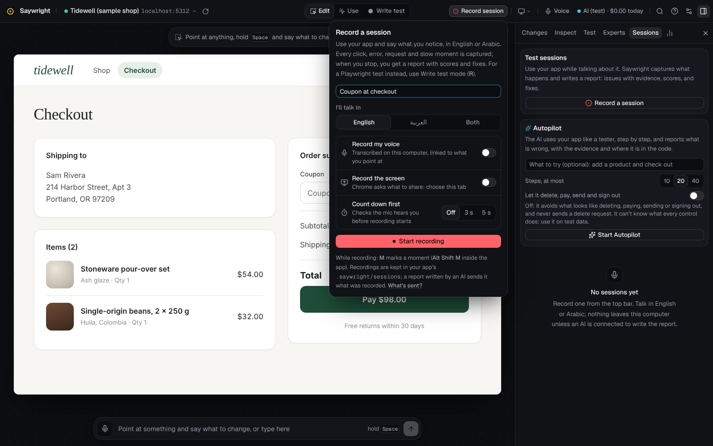
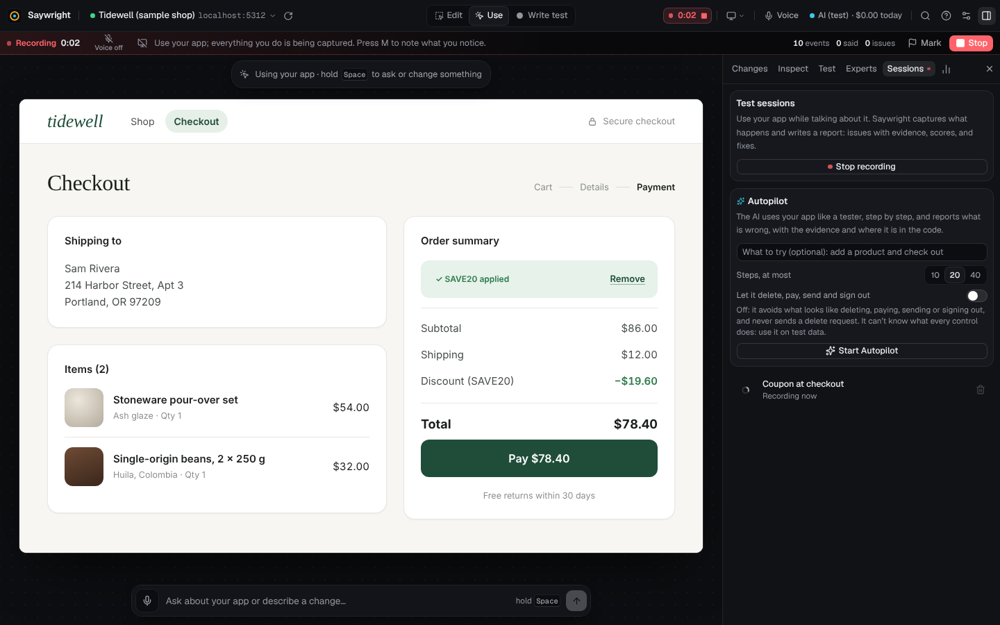
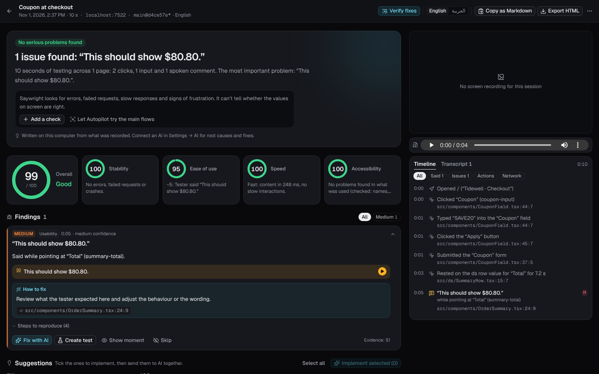
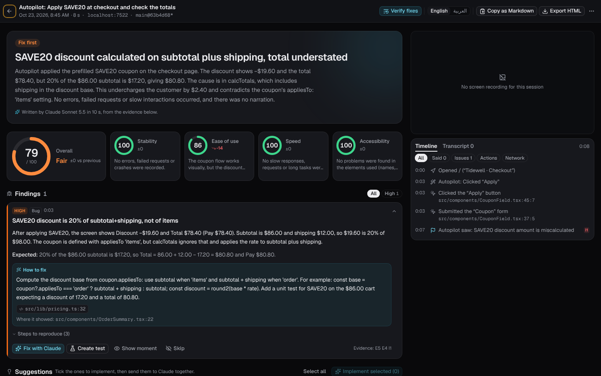
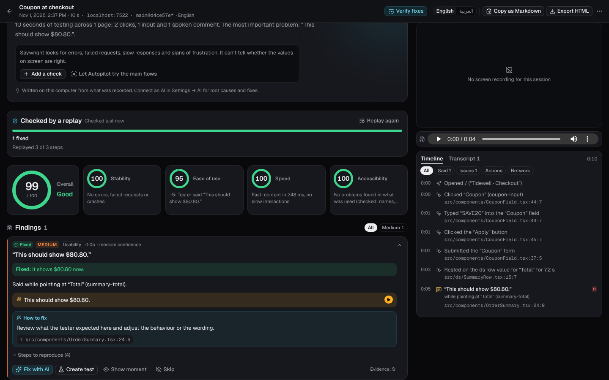

# Sessions and reports

Record yourself using your app and talk about what you notice as you go (“the total looks wrong”, “الزرار ده مش شغال”). When you stop, you get a report: what went wrong, with its evidence and the code behind it, scores, and suggestions, each a click from a fix. After you fix things, **Replay & verify** plays the session again and says, finding by finding, what is fixed.

- [Record a session](#record-a-session)
- [What is captured](#what-is-captured)
- [Before recording: the countdown](#before-recording-the-countdown)
- [After you press Stop: how the report is made](#after-you-press-stop-how-the-report-is-made)
- [The report](#the-report)
- [After you fix: Replay & verify](#after-you-fix-replay--verify)
- [What leaves your computer](#what-leaves-your-computer)

To let the AI use your app and write the same kind of report, see [Autopilot](autopilot.md).

## Record a session

**From the studio.** Click **Record session** in the top bar (or **Record a session** in the Sessions tab). Name it if you like, choose the language you'll talk in (*English*, *العربية*, or *Both*, for Arabic and English, even in one sentence), whether to record the screen, and the countdown (3 seconds, 5, or off). Click **Start recording**. The studio switches to Use mode, so your clicks go to your app. Under the voice wave you see whether you are being heard. Mark a moment with <kbd>M</kbd>, or by saying “mark this” / “علّم هنا”. Click **Stop** when you are done: you can start the next session straight away, while the report is written.

**From your app's own tab.** With the plugin or the script tag, your app shows a small **Record session** button in its bottom-right corner while you develop, so you can test full screen, in any tab, without the studio open (the studio must be running). <kbd>Alt</kbd>+<kbd>Shift</kbd>+<kbd>R</kbd> starts and stops, <kbd>Alt</kbd>+<kbd>Shift</kbd>+<kbd>M</kbd> marks a moment, <kbd>Alt</kbd>+<kbd>Shift</kbd>+<kbd>D</kbd> hides the button, and while recording shrinks the recorder to a small dot, out of the page's way (<kbd>Option</kbd> for <kbd>Alt</kbd> on a Mac); its ⇆ button moves it to the other side of the page. Recording carries on across reloads and page changes, and across a restart of the studio (what is recorded meanwhile is sent once it is back); after a reload, click **Share screen** to keep taking screenshots.

Sessions are listed in the side panel's **Sessions** tab, newest first, with their scores.

## What is captured

| | |
| --- | --- |
| What you did | Clicks (and on what, with a Playwright locator), typing (passwords and card numbers masked), page changes, scrolling, what you rested the pointer on |
| What went wrong | JavaScript errors and unhandled promise rejections (with the line in your code, through source maps), console errors, failed and slow requests, data requests answered with a web page (a missing API route), repeated clicks, clicks that did nothing, clicks on disabled buttons |
| How it felt | Page speed: largest contentful paint, layout shifts, slow interactions, long tasks |
| What you said | Your narration, transcribed on your computer, each sentence linked to what you were pointing at and to the code behind it |
| What the screen said | The page's text (its main region, and dialogs and messages shown outside it) as each page opened, and again once the screen settled after each thing you did, when it changed. Card numbers are masked; what you type in password and card fields is never read. |
| What it looked like | Screenshots at the moments that matter (errors, speech, clicks, marks), and a video if you record the screen |

Recording starts in your app before the studio says “Recording”. Events are numbered and stored in order, sent again if a request fails, kept in the tab across a reload, and counted once. A busy app is recorded in full: quick, successful requests to the same address within a second are counted as one event. If the studio stops answering, the page keeps up to 5,000 events, and the report says how many it had to drop.

## Before recording: the countdown

Pressing **Start recording** first asks for the screen (if you record it), then opens the microphone, and counts down in the middle of the screen. Meanwhile it checks:

- **the microphone** is open and sends sound (a muted or dead one sends exact zeros, which no real room does), and shows the level as you talk;
- **the speech model** for the language you chose has loaded, so your first sentence is written down at once;
- **your app** is connected, so its events are recorded from the first moment.

The session starts when the count is over and all of that is ready: nothing said or done during the count is recorded. If something isn't ready, the countdown says what (*No sound from the microphone: check it isn't muted*, *The microphone is blocked*) and waits; **Start anyway** (or **Record without voice**) and **Cancel** are always there (<kbd>Enter</kbd> / <kbd>Esc</kbd>).

## After you press Stop: how the report is made

1. **The page hands over the last of the session.** Your app's recorder sends its last events, and the page sends the narration and screen recording still on their way, with the moment you pressed Stop.
2. **The last sentence is transcribed**, on this computer, by the same speech engine that transcribed the rest while you talked. Your voice never leaves your computer.
3. **The screen recording is finished**, so the report's player can scrub through it.
4. **Everything is pointed at your code.** Errors, clicks and requests are mapped back to your source files (`src/…:line`) through source maps.
5. **The studio analyses the session**, on this computer. It builds one timeline (actions, pages, errors, requests, slow responses, and every sentence you said with what you were pointing at), groups problems into issues with evidence (errors, failed or slow requests, clicks that did nothing, repeated clicks, slow responses to what you did, content jumping, accessibility, and things you said were wrong), and scores stability, ease of use, speed and accessibility. Waiting, reading, pausing and silence are never problems. In a long, noisy session, messages that differ only in numbers or ids count as one problem, and long lists are shortened with a count of what was left out.
6. **The report is written.**
   - **With an AI connected** (the one set for *Reports and reviews* in **Settings → AI**: your plan, an API key or a model on your computer), it gets an *evidence pack*: the issues with their ids, your narration, the timeline, what the screen said (each page as it opened, then what changed after each action, such as a total going from $98.00 to $78.40 after **Apply**), network and speed figures, the code around every place involved, the project code behind what you questioned (the modules those places import, ranked by what you said and capped at a few files), and up to six screenshots. It checks each result on screen against what the action should do, so a wrong total is found even when nobody said anything; then the code behind those actions is included too. It also gets the findings you set aside before and the sentences you corrected. It answers in a fixed shape: a verdict, a summary, findings (each with evidence ids, where it showed and the likely cause's file and line, the fix, steps to reproduce), suggestions, and next steps. The studio checks that every piece of evidence it cites exists. It writes in the language you spoke.
   - **Then it is translated** into the other language (by the AI set for *Small jobs*), with the same findings, ids and code. You can read the report meanwhile and switch with **English | العربية**.
   - **Without an AI** (or if it can't be reached, or the budget stops it), the report is written on this computer from the analysis, in both languages: errors, failed requests, slow moments, signs of frustration, and what you said, each with its evidence.

     

7. **Report ready.** The bar says so.

## The report

- **In English and Arabic**: switch with **English | العربية** at the top.
- **Scores** out of 100 for stability, ease of use, speed and accessibility, and overall, compared with your previous session. A high or critical finding, found by the studio or by the AI, caps the overall score, and the verdict is never lighter than the findings.
- **What it can and can't tell.** With nothing serious found, the report says “No technical problems found” rather than “ready to ship”: a recording can't tell whether the values on screen are right. **Add a check** loads the session's steps into Write test, so you can point at a value and say what it should show, which becomes a test; **Let Autopilot try the main flows** covers the rest.
- **Findings**, most severe first, each with its evidence: what you said (play it), the error, the request, the screenshot, the moment in the video, and where in your code to look.
- **Suggestions**: fixes, improvements and additions.
- A **timeline** of everything, filtered by what was said, issues, actions or network, in step with the video or screenshots, and the **transcript**.

| In the report | What happens |
| --- | --- |
| **Fix with …** on a finding, or **Fix all** | One request to your AI (the one set for *Changes and questions*) with each finding's evidence: what happened, what you expected, what you said, the likely file and line, and the elements involved. It reads your code, finds the cause, and proposes one change. It appears live in your app as a preview to keep or undo. |
| **Skip** a finding | It is set aside: out of the counts, out of **Fix all**, out of the export, and the AI won't raise it again when the report is rewritten. **Restore** brings it back. |
| Tick suggestions, then **Implement selected** | The same as Fix all, for the suggestions you picked. |
| **Transcript** | Every sentence you said, with when and what you pointed at. Click one to hear it, or to correct a word (what the recogniser heard is kept), then **Rewrite the report**: the analysis and the report are made again with your words. |
| **Create test** | A Playwright test from the steps that led to that finding. |
| **Verify fixes** | Replay & verify, below. |
| **Copy as Markdown**, **Export HTML** | In the language you are reading, without skipped findings. The HTML is one self-contained page, right to left for Arabic. |
| **⋯ → Transcribe the narration again** (or **Transcribe as…**) | Redoes the transcript from the recording, after installing a better model or choosing another language. |
| **⋯ → Delete session** | Deletes its recordings, screenshots and report from your computer. |

## After you fix: Replay & verify

**Verify fixes** in a report plays the session again in your app and says, finding by finding, whether it still happens.

1. **The same start.** The page the session began on is loaded again, fresh, in the studio. A new session can't start while the replay plays, and the replay alone acts on the app: your clicks wait until it is over.
2. **The same steps.** Each click, typing, choice in a list and <kbd>Enter</kbd> the session recorded is found again by its Playwright locator (read as data, never run as code), scrolled into view, boxed in cyan (*Step 2 of 5*) and done the way a person does it, at the pace you went. It waits up to six seconds for a target to appear. If one can't be found (renamed, removed, behind a login), or is disabled (a person couldn't use it either), the replay stops there and says which step and why. A password or other secret the session typed was never recorded: the replay types the value saved for it in the Test tab's **Secrets**, or stops there. <kbd>Esc</kbd> or **Stop** stops it; what was played is still compared.
3. **The same checks.** A value you said something should show (“this should show $80.80”) is read from the element you pointed at, when the replay reaches that moment, if the session recorded how to find that element again. An amount a finding expects after a step (a total of $80.80 after **Apply**), that the session never showed, is looked for on the screen after the same step of the replay.
4. **Recorded and compared.** The replay is recorded like a session (it isn't listed as one) and analysed the same way. Each problem of the first session is looked for under the same key: the same error message, the same failing request, the same element doing nothing. Numbers in messages and addresses (ids, counts) don't matter.

| Verdict | When |
| --- | --- |
| **Fixed** | It didn't happen again, and the step before it did what it did the first time (for a request, the replay made it and it didn't fail), or the value said or expected is shown now. |
| **Still happens** | It happened again, or the value shown is still wrong (the screen after the step shows other amounts), or the element that should show it is gone, or a button that did nothing is still disabled. |
| **Couldn’t check** | A moment you marked, a remark with no value to read, how quickly something responded, a request the replay didn't make, a moment after a step the replay couldn't play, or a problem whose step changed nothing on screen in the replay when it did the first time: the replay never really got there. |

Problems the replay ran into that the session didn't have are listed as **New in the replay**. **Fix all** then leaves out what is fixed, and **Copy as Markdown** carries the verdicts into a pull request. **Replay again** after the next fix (only the latest replay is kept). The replay uses your app as it is now, with its logins and saved data: a fresh page load, not a fresh browser. All of it happens on this computer: nothing is sent anywhere.

## What leaves your computer

Only when an AI is connected: the evidence pack (with what the screen said), the code excerpts and the screenshots go to it to write and translate the report, and the findings and the code it reads go to it when you ask for a fix. With a model on your computer, nothing leaves it. Recordings, audio and transcripts stay on your computer, in the app's `.saywright/sessions/` folder (for an app linked by its address, in the studio's data folder): see [Data folders](configuration.md#data-folders).
